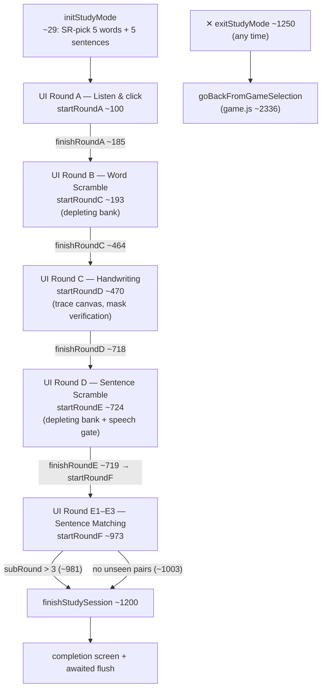
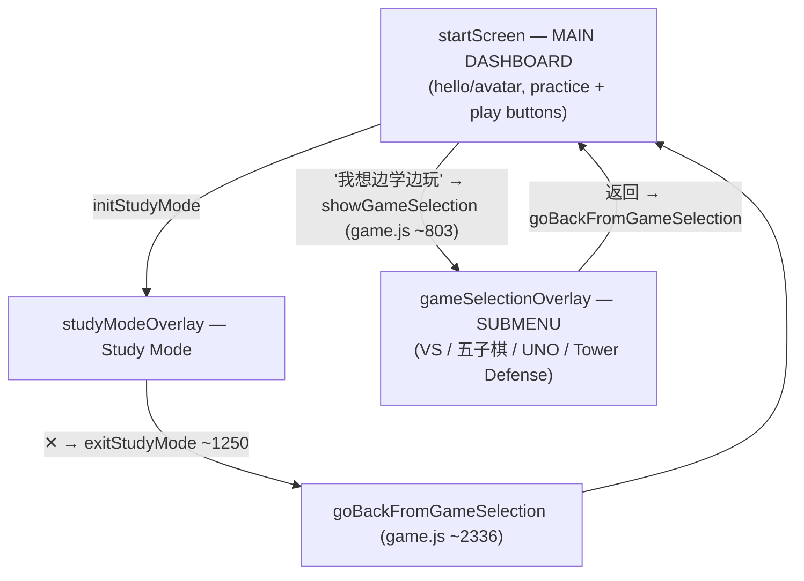

# Study Mode (UI Rounds A–D + Match; internal functions A/C/D/E/F)

Preview 2026-10-28c reuses the completed Round E tiles for speech hints: microphone attempts reset them to purple, then heard words become green. There is no repeated target prompt or second feedback sentence. Earned unscramble results and optional progression stay unchanged.

The 2026-10-28b optional speech-practice preview uses the existing sentence
gate call in `checkRoundE`. Learners can retry or continue after recording,
including recognition/microphone problems, without a pronunciation percentage.
The sentence-building SR result remains recorded before the speaking step;
continuing does not award speech mastery or repeat the earned grammar result.
Production keeps its current gate until explicitly promoted. See
[Speech Recognition](08-speech.md#optional-practice-preview--2026-10-28b).

Temporary remote diagnostics: optional handwriting checkpoints and neural worker errors feed the account-enabled recorder. No ink or learner interactions are added. See [Telemetry](14-telemetry.md).

## Handwriting neural/interaction preview (2026-10-22)

23 October final adjustment (2026-10-23e): guides start hidden for every letter.
Two nontrivial unsuccessful writing attempts automatically show the outline.
There is no guide button. The internal guide helper respects the effort gate.
An attempt must have at least HW_MIN_INK raw pixels and a stroke extending more
than six normalized units, so taps/dots do not unlock help. This is a simple
input-effort threshold, not an inference of intent or handwriting quality.
All judged attempts remain captured, while the five-attempt reveal safety net
also uses this separate meaningful-attempt counter. Any guide/reveal still marks
the word assisted.

23 October session-skip adjustment (2026-10-23c): skip starts hidden and disabled,
and the handler also blocks it. A meaningful rejected attempt with the guide
actually displayed unlocks skipping for the current word and every later word
in this Study session. Unguided failures, merely displaying a guide, and taps do
not unlock it. New Study/handwriting sessions reset the in-memory flag; no local
storage or cross-student carryover. Each click still skips exactly one word.
The erase controls use self-contained SVG erasers over a single stroke versus a
whole letter, short Chinese captions `一笔`/`全部`, and explicit accessible labels.

Round C/internal D uses a self-hosted worker recognizer warmed during the
preceding scramble round. Its 325KB checked/cached weights and runtime live in
`handwriting_model/`; its README explains development-only results and limits.
Retraining was evaluated, but the earlier checkpoint with revised calibration
performed better. The reserved benchmark remains unscored.

The widget checks after a 160ms pen-lift pause; uncertainty appears after another
540ms while retaining ink. A child can add strokes, freely erase one stroke or
the whole letter, receive guides after two meaningful failures, and use the
exact per-word `跳过这个词的书写` after the session's first guided failure.
Success advances after 140ms and word completion after 450ms. Canvas cap: 230px.
Pointerdown/clear/undo/guide/target/destroy invalidate asynchronous results.
Pointercancel retains ink without grading; pointerup records its final endpoint
even without a move event. Supported coalesced movement samples are retained.
Lowercase i/j require a real upper dot; repeated stems do not count. A plain
capital I is acceptable. é uses a readable e body with optional detached accent
per the reviewed policy; spelling/display keep the accent.

The two-failure automatic guide/five-failure reveal safety net remains, but an unchanged
drawing is not repeatedly judged by timers. Undo silently checks remaining ink
for acceptance without adding failure. Any hint/reveal marks the word assisted
and queues `handwritingAssisted` instead of independent `handwriting`. Skips still
record neither completion nor SR; no handwriting SR success is introduced.
Collection remains separately gated and stamped engine 2; geometry alone cannot
replay neural outcomes or an earlier intermediate fallback pass.

`handwriting_preview.html` exercises the real widget/round with four example
words, in-memory counts, no account/collector/analytics/API scripts, and an offline
worker scoped only to the `handwriting_preview` URL prefix. The main update
worker is unchanged. Physical-device and mainland first-download checks remain.

> **Last verified:** 2026-09-04 · **Part of:** [Classroom-survivors Repo Wiki](README.md)

**Owner files:** `study_mode.js` (1360 lines — the whole subsystem), `index.html` (`#studyModeOverlay`, `#study-game-area`, exit X ~line 327), `style.css` (`.study-*` classes), `sr_engine.js` (content/pair selection helpers called from here), `game.js` (`playTTS`, `goBackFromGameSelection`, the global keydown guard).

Study Mode is the structured practice flow: 5 SR-selected words and 5 SR-selected sentences, drilled through five rounds of increasing production difficulty, plus three sub-rounds of sentence matching. Everything lives in one global `STUDY_STATE` and a set of top-level functions; there is no class.

## New exercise POC (2026-10-13)

A separate [interactive illustrated notes POC](../interactive-notes-poc.md)
now lives at `interactive_notes_poc.html` for PU3 U9 p111. It shows all four
original infographic pages with tappable word/sentence audio; it loads no speech
model and requests no microphone. It does not change
Study rounds, curriculum availability, SR, student completion or rewards.

`new_exercises_poc.html` is an independent test surface for PU3 Unit 9 page 109.
Every load or New Set action samples two distinct missing-word boards from M1-M6,
then two distinct find/fix boards from F1-F8 in the Study presentation; it then
independently samples the same two-M/two-F pattern for the game presentation.
Eight boards total, one shown at a time. Duplicates are excluded within each
presentation; the same exercise can appear in both presentations.
Its controller/chrome are `new_exercises_poc.js`/`.css`; the curriculum, widget
and styling are shared with the real app through `non_spelling_content.js`,
`non_spelling_widget.js` and `non_spelling_exercises.css`.
It loads the actual production `style.css`, Tailwind, fonts and Font Awesome.
The shells reproduce `index.html`'s `#studyModeOverlay`/`#study-game-area` and
`#grammarGame .minigame-container`; the same widget is mounted into either shell.
Study keys use `.study-letter-btn`, game keys use `.letter-bubble`, and actions
use `.game-btn`. Both themes use the real theme styles and toggle.
The POC defaults to kid-friendly when no theme preference exists, preserving an
explicit saved dark/light choice. New sentence text uses the production exercise
tile weight (700), compact raised answer fields and individual sentence cards.
Static words wrap at word boundaries; short trailing clauses stay grouped to
avoid isolated final words. Find/fix source words use `.study-word-tile` in Study
and `.draggable` in Game. Phone keyboards use two balanced rows when needed;
desktop keyboards remain on one row when space permits. Frozen keys retain their
normal colour, while CLEAR/backspace are secondary controls in the warm theme.
Feedback uses the existing word tiles' green/red gradients, raised edges and
readable white lettering. Correct words have a small check badge; mixed answers
colour individual letters and briefly shake. The compact raised bin has a drawn
lid that opens when a word is selected, a removed-word chip and an undo action.
After CHECK, the bin turns green/red with a check/cross beside its icon, grading
word selection independently from replacement spelling. A correctly selected
mistake stays neutral, is crossed out, then slides into the open bin; the lid
closes with a small bounce. The 850ms animation ends before Study auto-advance,
and reduced-motion mode removes the word immediately. A wrongly selected word
stays visible beside the red bin. Feedback messages include an icon, and game success
leaves clearance for the bouncing power-up button. New feedback motion honours
the reduced-motion preference.
Short phone screens reserve space for the floating theme control, condense
spacing and use one keyboard row for four/five keys. The game reward scrolls
into view when the card needs vertical scrolling.
Player instructions, hints, grading messages, summary
text and accessible control labels use Simplified Chinese in both presentations.
Exercise titles and controls (CHECK, CLEAR, Bin, GET POWER UP) stay English in
Study and Game, matching the main app's exercise UI. Navigation/retry actions
remain Chinese, like the main app menus. The page is `zh-CN`, with English
headings, exercise control labels and practice sentences marked `en`. Chinese UI
text has explicit system font fallbacks; English exercise typography is retained.

- Missing-word boards use the approved paired sentences and one target per blank.
- Find/fix makes every word selectable; tap word then bin, or drag with mouse/touch.
- Reusable keyboards contain only unique target letters, shuffled once per board,
  with no filler letters. A wrong-word selection still shows the target keyboard.
- CHECK grades letter position separately from the find/fix word selection.
  Wrong answers freeze editing, reveal feedback for three seconds, then reset
  the complete board, restoring the original binned word. CLEAR can reset sooner.
- Empty boxes receive a nudge without grading. A later success keeps the first
  failure in the in-memory test summary. Study success advances after 1.2 seconds;
  game success shows the production-style GET POWER UP action, which advances
  the POC rather than awarding a real game reward.
- PC letter keys/Backspace/Enter work, and native phone keyboards never open.
- This POC has no login, analytics, SR persistence, production game/auth script
  loading, or changes to the curriculum packs. The visual assets are shared;
  the real preview integration is described in the mixed-round section below.

Run `node serve_new_exercises_poc.js` from the feature worktree. PC URL:
`http://localhost:8123/new_exercises_poc.html`; a phone on the same router uses
the PC's LAN address and port 8123. Ethernet plus Wi-Fi is supported. VPN LAN
blocking or Windows inbound filtering can prevent access. The server only serves
the POC files and allowlisted production visual assets, not arbitrary workspace files.
Optional positional argument changes the port, e.g. `node serve_new_exercises_poc.js 8124`.
The page also opens directly from disk on a PC.

## 🔴 The naming is off by one — trust code, not names

The **function names are shifted by one round relative to the UI labels**. `startRoundC` implements UI "Round B", `startRoundD` implements UI "Round C", and so on. The internal round keys also skip `'B'` (`STUDY_ROUNDS = ['A','C','D','E','F']`, `study_mode.js ~1265`). All freeze flags and timers follow the *internal* key (`_roundCFrozen` guards UI Round B).

| UI label (what the student sees) | Internal round key | Entry function | What it actually does |
|---|---|---|---|
| "Round A: Word Recognition" | `'A'` | `startRoundA (study_mode.js ~100)` | Listen to TTS, click the matching word |
| "Round B: Word Scramble" | `'C'` | `startRoundC (study_mode.js ~193)` | Letter bank → slots (depleting bank) |
| "Round C: Handwriting" | `'D'` | `startRoundD (study_mode.js ~470)` | Handwrite up to 6 random gaps on a trace canvas; the other letters are given |
| "Round D: Sentence Scramble" | `'E'` | `startRoundE (study_mode.js ~724)` | Word tiles → sentence slots (depleting bank) |
| "Round E1–E3: Sentence Matching" | `'F'` | `startRoundF (study_mode.js ~973)` | Match question tiles to answer slots, 3 sub-rounds |

Progress-bar labels (`STUDY_ROUND_LABELS`, ~1266) are `A:'Listen', C:'Scramble', D:'Write', E:'Sentence', F:'Match'` — also keyed by the internal names.

## Lifecycle

### Preview notes and page-scoped Study (preview only, 2026-10-27)

`PreviewNotes.onLogin()` opens the registered PU3 U9 p111 four-page reader for
an unfinished student, whether assigned manually or reached through SR advance.
The advance loop stops at an unfinished note before evaluating its cooldowns;
fresh note placement is not overridden by a stale pending local advance.
The Chinese `开始学习` action (no listening gate) calls
`initStudyMode({previewNoteId:'pu3-u9-p111'})`: five uniformly shuffled distinct
items from this page's original 14-word vocab array, plus five random distinct
boards from `NonSpellingContent.selectPage`. `pageOnly` filters before pooling,
so older-page due items cannot leak into this introductory session. All four
types are eligible: 12 scrambles, page-local pair boards, the existing 8 M and
14 F items. A random five-board draw need not contain every type.

The standard A/C/D/E internals, mixed widgets, first-attempt SR tracking and
acknowledged flush are reused. No content arrays, approved M/F wording or locked
prefixes change. Only a fully finished five-word/five-board session carries
`data.previewNote` on its **single ordinary `sessionType:'study'` event**, so SR
and weekly targets count it normally and only once. Partial exits retain normal
observed SR outcomes but do not complete the note. The main-menu `预习笔记`
button appears only after at least one preview Study session is completed,
  including immediately after the first completion. The library reopens completed
  notes in listening-only review mode. A student-scoped
local mirror covers pending offline delivery; the durable server map is returned
with the normal login. See [data model](11-data-model.md).

`initStudyMode (~29)`: reads `selectedClassContent` (book/unit/page), pulls content via `getStudyContentSR(book, unit, page, 'vocab'|'sentences', 5)` (sr_engine.js). Fewer than 5 of a kind shows a non-blocking notice (`showStudyNotice ~20`, replaces `alert()`) and runs a shorter session; zero of either aborts. It then sets `active=true`, resets SR tracking (`srStudyResults=[]`, `srUsedPairKeys=new Set()`), hides the start screen and every other overlay, **stops the Phaser scenes** (`MainScene`, `UnoScene`), hides the canvas, clears `minigameCountdownInterval`, hides the VS HUD buttons, sets `activeGameMode = null`, and shows `#studyModeOverlay`.

## STUDY_STATE shape

Declared at `study_mode.js ~2`; behavior fields are added dynamically by the rounds:

| Field | Meaning |
|---|---|
| `active` | Study Mode running. **Must be reset to `false` on exit** (see [exit pitfall](#exit-path--the-study_stateactive-trap)) |
| `words`, `sentences` | The 5 SR-picked words / sentences for this session |
| `remainingWordsRoundA` | Round A: words not yet recognized |
| `currentWordIndex` | Shared cursor for UI Rounds B and C |
| `currentSentenceIndex` | Cursor for UI Round D |
| `round` | Internal key `'A'…'F'` (drives the keydown router, ~1311) |
| `startTime`, `timerInterval` | Session timing |
| `isTransitioning` | Blocks ALL input during the 1–1.5s success advance (and the Round F 2s reset) |
| `srFinalized` | Set in `finishStudySession`/exit so results aren't double-finalized |
| `_roundCFrozen` / `_roundEFrozen` | Per-round freeze during wrong-answer reveal (UI Rounds B / D) |
| `roundDSlots`, `roundDGapOrder`, `roundDCursor`, `roundDAttempts`, `roundDGuided`, `roundDTrace` | UI Round C handwriting state: 1:1 slot model, the gap indices, the gap being written, failures on it, whether the outline has faded in, and the trace-box widget |
| `subRound`, `sentencePairs`, `pairAttempts[]`, `pairQueued[]` | UI Round E matching state |

Module-level globals: `srStudyResults` (per-item `{type, key, firstAttempt}` records, ~16) and `srUsedPairKeys` (pairs already shown in UI Round E this session, ~17).

## Round reference

### UI Round A — Word Recognition (`'A'`)
`renderRoundAWords (~122)` renders the 5 words as buttons (shuffled, removed on success — no re-layout). `playRoundAPrompt (~147)` picks a random *remaining* word, sets the global `currentTTSWord`, and plays TTS after 500ms (translation hint + vocab image via `showTranslation`/`showVocabImage`, game.js). `checkRoundA (~160)`: correct → scale-out animation, remove from list, next prompt; wrong → `synthError()`, red shake, replay TTS after 600ms. Guards on `isTransitioning`.

### UI Round B — Word Scramble (`'C'`) — **depleting bank**
Containers: `#scramble-slots` (answer) + `#scramble-bank` (source), built by `nextRoundCWord (~201)`.

- **Slots**: one `.study-slot` per character. Letter slots are wrapped in `.word-group` divs; separators (` `, `-`, `.`, `?`, `!`) are direct flex items with `dataset.fixed="true"` (space is invisible; the other four render their glyph).
- **Bank**: the word's letters minus separators, shuffled, as `.study-letter-btn` buttons. **The bank DEPLETES**: `addLetterToSlot (~304)` places into the earliest empty non-fixed slot and **removes the clicked button** (~321). Clicking a placed letter (`removeLetterFromSlot ~324`) clears the slot and appends a **fresh** bank button — the gap stays (no reflow).
- `roundCSlots (~300)` is the ONLY way to enumerate slots: `querySelectorAll('#scramble-slots .study-slot')`. `#scramble-slots.children` are the `.word-group` wrappers — indexing them silently corrupts state (see [.word-group convention](#the-word-group-dom-convention)).
- `checkRoundC (~354)`: incomplete → soft `synthError()` nudge, no reset. Grades every non-fixed slot against `targetWord[i]` (full-string index; fixed slots occupy their own positions). Correct → freeze + `isTransitioning`, SR success push, `queueExerciseEvent('wordScramble','study',word)`, advance after 1s. Wrong → freeze, SR failure recorded **at the first wrong check** (`exerciseAttempts === 1`), `incrementExerciseAttempts()`, and a 5s reset that returns EVERY letter to the bank before unfreezing. Quirk: this widget stores the reset timer **per slot** (`slot._resetTimer`), not on `STUDY_STATE`.
- `clearRoundC (~438)`: blocked only during the 1s success transition. Clears every slot's `_resetTimer`, returns letters to the bank, unfreezes — **CLEAR must stay live during the reveal**.

### UI Round C — Handwriting (`'D'`) — write the missing letters
`nextRoundDWord (~478)`: one slot per character; `hwPickGaps(word, ROUND_D_MAX_GAPS=6)` (handwriting.js) picks up to **6 random letter positions** as gaps the student must handwrite, left-to-right. The remaining letters render as given context (`.hw-slot-given`, dashed border), so a 20-letter item costs the same as a 6-letter one. Separators (`[' ',"'",'-','.','?','!',',']`) render as `.hw-slot-fixed` — no box at all; the kid theme forces a background onto every `.study-slot` with `!important`, so `.hw-slot-fixed` needs its own kid-mode `!important` override or a ghost box appears where the space is.

- **Verification, not classification.** The target letter is always known, so the student's ink is compared against a mask rendered from that one glyph in Fredoka (`hwGlyphMask`, 128×128; `hwEnsureFont()` is awaited in `startRoundD` so the mask is never a fallback font's shape). `hwVerify` returns *precision* (ink inside the dilated guide), *recall* (guide covered by dilated ink), *missingPart* and extent ratios; `hwAccept` applies the active profile's bars. All maths runs in a fixed 128×128 mask space, so thresholds are independent of canvas size and devicePixelRatio.
- **Four bars, because coverage alone is blind to missing strokes.** A crossbar is ~2% of a t's ink and a dot ~15% of an i's, so precision/recall happily accept a bare stem for t, i or j. Backing them up: (1) `missingPart` — the largest *stroke-thick* connected piece of the guide left unwritten (`hwMissingPart`, erosion drops wobble slivers); (2) `HW_MIN_EXTENT` — after normalisation the ink must be ≥70% as wide and tall as the glyph; (3) `minStrokes` — a glyph the font draws in separate pieces (`hwGuideComponents`: i, j) cannot be written in one unbroken stroke, counted against the target's own case so a bare stem cannot hide behind capital I; (4) `overfilled` — a solid fill of an over-large box is not a letter. `hwNormalise` anchors the ink's baseline to the guide's and recentres it horizontally, so WHERE the child writes never matters; only the scale clamp [0.75, 1.35] bounds size. The pen (`HW_PEN` 9) is deliberately NARROWER than a glyph stem (~11) — a fat pen blankets neighbouring letters' ink, which is what let c-for-a and a-for-g through.
- **Placement cues were tried and removed.** Authored start/end dots (`HW_STROKE_CUES`, UK infant print order) shipped for one round; the teacher rejected them because several dots sat slightly off the glyph, and asked for shape-only judging instead: "an a written like an a passes, no matter if slightly left, right, too high, too low". Position is therefore forgiven completely (ink recentred onto the guide) and size within `HW_SCALE_MIN/MAX`; the scale range stays bounded because beyond it a half-drawn stem stretches enough to impersonate a complete letter mid-stroke, and extremes fall to the outline scaffold. `hwScoreLetter` compensates the tolerance band for the pen thickness the rescaling adds or removes.
- **Pen lifts are legal.** A lift that does not complete the letter is not judged: the widget waits `HW_STROKE_GAP_MS` (1.5s) for the next stroke before the attempt counts (`pendingReject` in `hwCreateTraceBox`). A lift that DOES complete it accepts immediately, so multi-stroke letters need no "done" button. Either case is accepted; capitalisation is not this round's battle.
- **Scaffold ladder** (`roundDRejectLetter`): attempts 1–2 are a blank box at the `free` profile; from attempt 3 the outline fades in (`roundDTrace.setGuided(true)`) at the `guided` profile — looser on fill and on missing parts (a trace over the outline that stops short must still pass) but STRICTER on cover, because with the outline visible, stray ink off the letter is a worse signal; at attempt 5 (`ROUND_D_GIVE_UP_AFTER`) the letter is revealed as `.hw-slot-revealed` so a child can never dead-end. Erase (`clearRoundD`, or Backspace via `handleRoundDKeyDown`) is free — it does not count as an attempt.
- Accept → `synthGem`, slot turns `.bg-green-500`, 420ms, next gap. Word complete → `queueExerciseEvent('handwriting','study',word)` and the 1s advance. **Like the old spelling round, this round pushes no `srStudyResults` record** — it affects analytics only, never spaced repetition.
- **Skip per word:** after the session's first meaningful guided failure, `跳过这个词的书写` (`skipRoundDWord`) skips all remaining handwriting for the current word. It stays available on later words, including before writing on those words. A new session locks it again. A 300ms input lock prevents double taps from skipping a second word. Skipping the final word continues to the sentence round. A skip queues no completed-handwriting event, adds no SR result, and plays no success sound. Already judged traces still go through the existing gated capture path. Destroying the canvas cancels pending pen-lift judgements; the shared `roundDTimer` cancels letter/reveal advances on skip and all pending handwriting advances on exit.
- `hwCreateTraceBox` owns the canvas and the Pointer Events (`touch-action: none` stops the page scrolling mid-trace) and registers window resize/orientation listeners — `exitStudyMode` destroys the widget or the listeners accumulate across sessions. It also writes `window.__hwLast` (target, verdict, precision, recall, missingPart, stroke counts, extent ratios, the bars in force) after every judgement.
- **Known limitation, do not "fix" blindly:** in Fredoka the t crossbar is ~2% of the glyph and a single-story a's stem sits where a c's tips flare, so "l for t" and "c for a" cannot be refused by any geometric bar that still accepts good letters. Tune the bars **offline against the downloaded traces** (below) — real ink, and a candidate bar can be scored against every stored letter at once instead of one child at a time. The widget still writes `window.__hwLast` (target, verdict, precision, recall, missingPart, stroke counts, extent ratios, the bars in force) for console diagnosis. A live `?prec=/?recall=/?miss=` harness (`hw_dev_entry.js`) existed on the handwriting test repo during development and was **deleted before shipping**: it bypassed the start screen and could loosen the bars from a URL, so it was fenced to that site and localhost, and then removed rather than left inert in production. Reinstate it there, never here, if live tuning is ever needed. Synthetic pen paths are NOT a substitute for real traces: they proved unable to represent either good or bad letters faithfully (see `test_handwriting_browser.js`'s header).
- `test_handwriting.js` covers the pure mask maths; `test_handwriting_browser.js` draws pen paths derived from the glyph masks themselves and pins acceptance, the grace window, the stroke-count rule, the scaffold, the dead-end reveal and the `startRoundD()` entry point production actually calls.

#### ⏳ Trace collection (temporary, until 2027-01-31)

The bars above were tuned against synthetic pen paths, and nothing was ever kept — so a wrongly refused letter could only be reported anecdotally, exactly the blind spot the speech pipeline had before [§11.1 of the speech page](08-speech.md). `handwriting_sample_capture.js` now keeps the ink behind every judged letter so the geometry can be tuned against real classroom handwriting, and so a future classifier can be trained on it. Traces are a few KB per word, so this can run for months over the whole class and still cost nothing beyond request units the free tier already allows (~2500 RU/day for a full class).

- **What is stored:** one document per completed word — `word`, `book`/`unit`/`mode`, the engine constants it was judged under (`engine` = `HW_ENGINE_VERSION`, `size`, `pen`, `tol`), the canvas geometry (`boxPx`, `dpr`), `ua` (finger vs mouse changes everything about the ink), the display name, and `letters[]` where each entry is `{ch, ok, att, gui, rev, ms, p, r, mi, wr, hr, gc, st, mn, ov, s}` — the target, the verdict, which try it was, whether the outline was showing, whether it ended in a reveal, how long it took, every scoring number behind the decision (three decimals), `gc` = the guide's own pixel count, and `s` = the strokes as flat integer coordinate pairs in the engine's own 128-unit grid.
- **Coordinates are replayable within one rendering context.** `hwCompactStroke` rounds to integers and stride-samples to ≤`HW_MAX_TRACE_POINTS` (160) points per stroke. Measured on a realistic sweep (~1-unit spacing, what `pointermove` delivers) a compacted stroke rasterises to **99.5% identical ink**, and rounding the coordinates themselves changes no score at all (measured: 0.0000 across 26 letters). `test_handwriting_capture_browser.js` re-runs `hwVerify`/`hwAccept` on the stored coordinates and asserts both the verdict and the 3dp scores reproduce.
- **…but not bit-reproducible ACROSS devices, and that is the guide, not the ink.** `hwGlyphMask` thresholds antialiased text at alpha>90, so two browser contexts (headed vs headless, different GPU/text settings) can build guides that differ by a few percent — measured on real classroom traces as recall drift up to 0.03 and 1 verdict in 44 flipping. This is why `gc` is stored: it makes the difference measurable and lets a candidate bar be scored against guide-count-normalised recall instead of mistaking a heavier-rendering device for a worse-written letter. Do not claim cross-machine replay parity; replay in the same browser flavour the students use.
- **Deliberately NOT routed through `saveAnalytics`.** `queueExerciseEvent`'s `itemDetails` is stored verbatim in the student's own document, so traces would churn the 700-event archive, eat into the 2 MB item limit and be unexportable without dragging every child's progress record with them. Traces get their own container (`handwriting_samples`, partition key `/studentId`, same database so it shares the 1000 RU/s pool) and their own endpoint.
- **Gating (all three must hold or nothing is sent):** the server said this student is enabled (`GET /api/handwritingCaptureConfig`, once per session, fail-closed — `HANDWRITING_SAMPLE_IDS` unset/empty records nobody, `*` records every signed-in student); the window is open (checked client-side too, so no payload is even built after the deadline); the per-student daily word cap (`MAX_WORDS_PER_STUDENT_PER_DAY` 40, counted in **China-time** days on both sides, mirrored in `csHwWordsSent_<id>` as `{d,n}` so a shared tablet does not accumulate one key per day). Uploads are paced 2500 ms apart and dropped on any failure — a trace is never worth retrying, and never worth slowing the round for.
- **Buffered in memory, never persisted locally.** Letters accumulate in a closure while the word is in progress and only leave the device if all three gates pass at flush time, so a student who is not being recorded sends nothing at all. `test_handwriting_browser.js` runs a whole round of accepted and refused letters with capture disabled and asserts zero uploads.
- **Hooks** (`study_mode.js`): `hwCaptureBeginWord(word)` in `nextRoundDWord`, `hwCaptureLetter(ok, scores, attempt, revealed)` in `roundDAcceptLetter`/`roundDRejectLetter`, `hwCaptureEndWord()` in `roundDWordComplete` and in `exitStudyMode`. Two orderings matter and are pinned by tests: the rejection is recorded **before** `roundDTrace.clearInk()` wipes the strokes it refers to, and the accept is recorded **before** `roundDCursor++` moves off the letter. All three go through `hwCapture()`, which tolerates the module being absent, so deleting the collection cannot break the round.
- **Server-side bounds** (`saveHandwritingSample.js`): every number clamped, coordinates rounded into the grid, ≤20 letters per word, ≤40 strokes and ≤800 points per letter, non-finite pairs **dropped rather than repaired** (invented ink is worse than missing ink), and a 200 KB document cap that a legal payload cannot reach — so a real word is never refused for size, only a hand-built one. Identity comes from `token.sub`, never the body; a student who is not enabled gets a quiet `200 {skipped:'not_enabled'}` so a child never sees an error.
- **Export:** `cd api && node download_handwriting_samples.js [--out dir] [--limit N] [--student id]` → `handwriting_samples/manifest.csv` (one row per judged letter: `ch` is the ground truth, `ok` is what the shipped geometry decided, `p`/`r`/`mi` are the numbers behind it, `strokes` as `x,y x,y|…`) plus `words.jsonl` with the raw documents, and a console table of per-letter refuse rates — the first thing to read when a child says "it wouldn't take my letter". Output is gitignored: these are children's handwriting samples tied to a student id, and the repo is public.
- **Removal:** delete `handwriting_sample_capture.js` and its `<script>` tag, `test_handwriting_samples.js`, `test_handwriting_capture_browser.js`, both API functions, `shared/handwritingSamples.js`, `getHandwritingContainer()` in `shared/db.js`, both routes in `corsOptions.js`, the three `hwCapture*` helpers and their four call sites in `study_mode.js`, `takeTrace()`/`hwCompactStroke`/`HW_ENGINE_VERSION`/`HW_MAX_TRACE_POINTS` in `handwriting.js`, the download script, this subsection, and the downloaded directory. The server-side window check makes the whole thing inert on the deadline even if it is forgotten.

### UI Round D — Sentence Scramble (`'E'`) — **depleting bank + speech gate**
`nextRoundESentence (~732)`: one `.sentence-slot` per token in `#sentence-drop-zone` (`dataset.expected`), shuffled `.study-word-tile` buttons in `#sentence-word-bank`. Array-wrapped sentence entries are unwrapped (`sentence[0]`).

- **Delegated listeners only** (~784, ~790): `bank.onclick` → `placeWordTile` for `e.target.closest('.study-word-tile')`; `dropZone.onclick` → `deleteWordTile` for `.study-word-tile.placed`. **Never add per-tile `onclick`** — the same click then fires twice (double-place / double-return).
- `placeWordTile (~812)` moves a **copy** into the earliest empty slot and removes the bank tile (depletes). `deleteWordTile (~829)` re-creates a bank button.
- `checkRoundE (~866)`: per-slot compare vs `dataset.expected`; tiles get `!bg-green-500`/`!bg-red-500`. Correct → SR success (`type:'sentences'`), `queueExerciseEvent('sentenceScramble','study',…)`, then the **speech gate**: if `window.SpeechStatus.isReady() && window.SpeechUI.makeSentenceGate`, the CHECK/CLEAR row is hidden and the gate is rendered *into the bank's space*; `onDone` advances. If speech isn't ready the skip reason is logged via `window.__speechLog` (~930 — "without this the skip is invisible in the field") and a 1s timer advances. The gate never affects SR state.
- Wrong → `_roundEFrozen = true` (not `isTransitioning`, so **CLEAR still works**), border flashes red, SR failure at first wrong check, `_roundEResetTimer` 5s: all tiles returned to the bank, unfreeze. `clearRoundE (~841)` does the same immediately and cancels the timer.

### UI Round E1–E3 — Sentence Matching (`'F'`) — **not depleting**
`nextRoundFSubRound (~980)`: 3 sub-rounds; pairs come from `getStudySentencePairsSubRoundSR(book, unit, page, srUsedPairKeys, preferPrevious = subRound > 1)` (sr_engine.js) — due pairs always win; E1 favors the current page, E2/E3 review earlier pages. If no unseen pairs exist anywhere up to the current page, Round F ends cleanly. Shown pairs are recorded in `srUsedPairKeys` so later sub-rounds pull fresh ones.

- `renderRoundF (~1017)`: question rows (`.sentence-a` + `.sentence-b-slot`), shuffled answer dock `#sentence-b-dock`. Tiles MOVE between dock and slots (same DOM node) — the dock never depletes.
- `selectBTile (~1061)` selects (yellow ring); `handleSlotClick (~1071)` places into a slot or returns a placed tile via `returnTileToDock (~1092)`.
- `checkRoundF (~1099)`: text-match per slot; each pair's SR result is queued once (`pairQueued`) with `firstAttempt = pairAttempts === 1`; failures recorded at the first wrong check per pair. All correct → 1.5s advance to the next sub-round; else 2s `resetRoundF (~1183)`.

## CHECK → reveal → reset (shared anti-cheese pattern)

Every drill round uses the same loop: **CHECK** → grade → color green/red → (wrong) **freeze editing for ~5s** → auto-reset to a clean board → (or CLEAR to skip the wait). Rules that were all ship-breaking bugs once:

1. Editing handlers (`addLetterToSlot`, `typeRoundD`, `placeWordTile`, …) early-return while frozen/transitioning.
2. **CLEAR stays live during the wrong-answer reveal** (only the 1s success transition blocks it). It cancels the pending reset, restores the source, and unfreezes.
3. The 5s reset must **restore depleting sources** (fresh bank buttons appended), never a bare `.remove()` — the 2026-07 "words vanish after 5 seconds" regression.

## Static palette vs depleting source

| Widget | Source | Behavior |
|---|---|---|
| UI Round B bank (`#scramble-bank`) | **DEPLETES** | Click bank letter → moves into earliest empty slot, bank tile removed; click placed letter → fresh tile back in bank |
| UI Round C trace box (`.hw-trace-canvas`) | n/a (ink, not tiles) | Pen strokes accumulate; acceptance is per-letter and immediate, so there is no CHECK button and no whole-word reveal |
| UI Round D bank (`#sentence-word-bank`) | **DEPLETES** | Tile moves to slot; placed tile returns as a fresh button |
| UI Round E dock (`#sentence-b-dock`) | STATIC (moves) | Same tile node shuttles dock ↔ slot |

Because three sources deplete, any reset/CLEAR path must rebuild the source from the placed tiles. Never "fix" a depleting source back to static (user-locked UX).

## Fixed-character (pinned) slots

In UI Round B, characters in `[' ', '-', '.', '?', '!']` render as **pinned** slots (`dataset.fixed="true"`, `nextRoundCWord ~237–257`): pre-filled, not clickable, never moved into the bank by reset/CLEAR, skipped by grading.

**Deliberately NOT pinned (draggable tiles the student must place):** apostrophe `'`, comma `,`, curly apostrophe `'`. This is a user decision — students must manually place apostrophes in contractions (`doesn't`, `I'm`); comma stays a tile in `yes, it is`. UI Round B and the game-mode word scramble must behave identically for separators (game.js mirrors this with its own `punct` array — change BOTH together, see [Game Modes](06-game-modes.md)).

**Policy: when the user points at a word whose separator is outside the pinned set, tell them — don't auto-extend the list.**

## The `.word-group` DOM convention

Letter slots in the answer rows are wrapped in `.word-group` divs so a word (e.g. `danced`) never breaks across lines; separators sit between groups so wrapping only happens at word boundaries. Consequence: **never index slots via `container.children[i]`** — the direct children are groups. Always use a `.study-slot` descendant query (`roundCSlots()` in production). UI Round C's row is rendered as HTML strings with `` (`renderRoundDSlots ~560`). `fitAnswerArea` (game.js ~1371) shrinks `--answer-font`/`--slot-size` when a long word would overflow narrow phones.

## Keyboard support

`study_mode.js` registers one global `keydown` listener (~1311): `if (!STUDY_STATE.active) return;` then routes by `STUDY_STATE.round`:

- Internal `'C'` (UI Round B) → `handleRoundCKeyDown (~1321)`: Backspace removes the last filled letter-slot; letter keys click the first matching bank button; Enter = CHECK.
- Internal `'D'` (UI Round C) → `handleRoundDKeyDown (~1330)`: Backspace = `clearRoundD` (wipe the current letter's strokes). No letter typing — input is the trace canvas.

## SR recording rules

- Success: `{type:'vocab'|'sentences'|'sentencePairs', key: itemKey(item), firstAttempt: exerciseAttempts === 1}` pushed at the successful check; `queueExerciseEvent(...)` fires the analytics event.
- Failure: pushed **at the first wrong check** per item (UI Rounds B, D, E), so quitting after a mistake still marks the item due next session. `finalizeSession` collapses first-failure + later-success.
- Partial sessions: `exitStudyMode` finalizes non-committed results with `finalizeSession(srStudyResults, false)` (~1254); completed sessions are finalized in `finishStudySession`.

## Session end, exit, and the two big pitfalls

`finishStudySession (~1200)`: sets `srFinalized`, calls `finalizeSession(srStudyResults)`, queues the `study` session event, then **awaits `flushAnalyticsWithDeadline(4000)`** before showing the completion screen — the 2026-08-25 "Doris refresh" fix (iOS WebKit can restart the page within ~1s; a fire-and-forget flush lost the session).

### Cooldown floor — a null pool must never dead-end a session (2026-09-08)

Success doubles SR intervals, so a long-term successful student eventually has EVERYTHING on cooldown (proven on live data: 148/148 pairs, E1 returned null → session fell back to menu). The floor, in `sr_engine.js` + `teaching_content.js`:

- `sortPoolBySR` drops group-4 from pick order but keeps it on `sorted._cooldown`.
- `pickWithNewQuota` serves least-overdue cooldown items when pickable runs short.
- The study pair selector reports group 4 (not 6-"empty") for all-cooldown pages and tops up to 3 pairs — a null now means TRULY no pairs exist.
- Rule: practice beats a dead session. Pinned by Rule5 in `test_round_e_dedup.js`.

### Sticky page-advance (2026-09-08)

`checkAndAdvancePageIfAllOnCooldown` (frontend_auth.js ~1722) moves a fully-cooled student up one page — but the decision used to evaporate when `updateStudent` failed, then re-decide "stay" at an incremented sessionCount. The pending page now persists in `csPendingPageAdvance`, re-applies at login BEFORE the normal check (`reapplyPendingPageAdvance`), and clears only on server confirm.

### CHECK comparison: `normMatchText` (2026-09-08)

Tile text is interpolated into HTML with surrounding whitespace, so strict equality could fail a visually-correct placement forever. Both `checkRoundF` (study) and `checkSentenceMatch` (game) compare via `normMatchText()` (`sr_engine.js`: collapse whitespace runs incl. NBSP → trim → lowercase). Display-text only — `itemKey` stays the storage key. Pinned by Rule6.

### Exit path & the `STUDY_STATE.active` trap

`exitStudyMode (~1250)` must do exactly three things, all load-bearing:

1. Finalize any observed-but-unfinalized results (partial credit).
2. **`STUDY_STATE.active = false`** — the game-mode global keydown listener (`game.js ~2253`) early-returns while this flag is true. If it is left `true`, physical-keyboard typing dies in the game-mode spelling minigame after any study session (shipped bug).
3. Hide `#studyModeOverlay` and call **`goBackFromGameSelection()`** (`game.js ~2336`) — the same function the 返回 (Back) button uses — which reveals `#startScreen` (the **main dashboard**) and hides `#gameSelectionOverlay`.

Wrong directions that shipped: routing the X through an undefined `triggerStartGame()` (froze the game on the VS HUD) and returning to `gameSelectionOverlay` (a submenu, not the main menu).

`startScreen` is the main dashboard; `gameSelectionOverlay` is a submenu; `studyModeOverlay` is the study surface. The exit X is wired at `index.html ~327`.

## Which tests cover this

- `test_widgets_regression.js` — jsdom harness loading the REAL scripts in index.html order; asserts the depleting bank, delete-preserves-gap, and freeze behaviors across the scramble widgets, plus the handwriting answer row (given/gap/active/revealed slots, invisible separators, ERASE safety).
- `test_handwriting.js` — pure Node tests of the mask maths in `handwriting.js` (rasterise, dilate, bbox, normalise, score, accept, gap picking) with synthetic rings; no canvas, no browser.
- `test_handwriting_browser.js` — Playwright + real Chrome: glyph masks read from actual Fredoka pixels, the pointer-driven trace flow, reject → scaffold → accept → reveal, and the 6-gap cap.
- `test_round_e_dedup.js` — VM test of the UI-Round-E sub-round pair-selection rules (due-first, page preference, no repeats) by loading `sr_engine.js` + `teaching_content.js`.

Both are in the `npm test` chain — see [Testing](12-testing.md). Related live behavior (speech gate) is covered in [Speech Recognition](08-speech.md); historic bug lore in [Gotchas & History](15-gotchas-and-history.md).

## Update discipline

Any agent that changes code covered by this page must update this page in the same commit. The wiki is the single source of truth; skills/memory hold only behavior rules and point here.

## Mixed Round D on preview (2026-10-13)

NON_SPELLING_ENABLED enables the new flow on preview and local/file development.
The production URL retains the legacy flow until release. A/B/C keep existing
recognition, word scramble and handwriting. Round D presents five boards chosen
by NonSpellingContent.select: sentence scramble, sentence match, missing words
and find/fix. At least three eligible types appear when available. Cooldown fills
shortages, never just the variety quota. Future pages are excluded; nearer pages
carry higher sampling weight. Matching boards use three unique pairs from one
page and count once, while pairs retain their independent legacy SR outcomes.

non_spelling_content.js adds nonSpellingExercises arrays from each page's legacy
sentences/sentencePairs, retaining those arrays and all vocabulary for compatible
readers. PU3 U9 p109 also receives the approved six M/eight F boards.
non_spelling_flow.js dispatches the existing scramble/match renderers and the
shared non_spelling_widget.js for typed boards; non_spelling_exercises.css scopes
the approved styling. Internal E/F handlers remain compatible; F is one matching
board inside the four-marker mixed round rather than a separate final round.

Typed SR uses stable non-spelling:<type>:<book>:<unit>:<page>:<id> keys in the
existing sentences bucket, preserving old history and the delta/merge API format.
The first submitted outcome is recorded once; retry success cannot promote a
failure. Five completed boards use the normal finalizer/flush. Exit retains
observed results without incrementing the session count. Widgets remove their
listeners/timers on advance/exit; old transition callbacks reject an abandoned
or replaced mixed session.

Due matching pairs remain reviewable even when cooldown partners are needed to
fill the three-pair board. Those partially cooled boards may win on SR priority,
but cannot be pulled solely to meet the type-variety quota.

PU3 Unit 1 page 16 now contains the 20 missing-word and 22 find/fix boards approved
on 2026-10-14. Past/present ability boards contrast could/couldn't with can/can't
in statements, replacing the rejected yes/no drills. The target-only reusable
keyboard includes an apostrophe for contractions; physical straight/curly
apostrophes both enter the same ASCII character used by the authored answers.
Vocabulary, legacy sentences/pairs and Unit 9 content are retained unchanged.

PU3 Unit 2 page 28 contains the 16 missing-word and 20 find/fix boards approved
on 2026-10-14. M2 pairs the café where breakfast happens with the pancakes which
were eaten. F9/F11 retain the approved teacher/tree-house relative clauses.
Three-blank boards M4/M5 grade all three targets before advancing. Earlier Unit 1
material remains available for weighted SR review, without making Unit 2 eligible
during Unit 1.

PU3 Unit 3 page 40 adds the approved 22 M/27 F boards. M22 has four blanks across
three rows, including two blanks in one row. F27 duplicates F8 and is excluded.
F28 uses two sentences without the rejected conjunction. When the wrong token
also occurs correctly elsewhere, optional wrongIndex pins the intended token;
the widget checks both its position and spelling rather than accepting any
occurrence of the same word. Earlier authored boards keep their existing SR IDs.

PU3 Unit 4 page 54 adds 16 M/20 F boards. Optional per-blank prefixes lock the first letter on M1-M8, M10-M13 and M15. The keyboard derives from remaining suffixes (so catch retains its second c); grading compares full words. CLEAR, backspace and retry resets preserve prefixes, and prefixes alone cannot submit. Other boards retain full blanks.

PU3 Unit 5 adds 16 M/20 F boards across the existing entries: page 57 has 3 M/4 F clothing boards; page 59 has 4 M/6 F made-of boards; page 66 has 9 M/10 F materials, properties and suggestion boards. Thirteen M boards retain locked initials. Earlier pages cannot sample later-page content, and legacy vocabulary/sentences/pairs remain unchanged.

PU3 Unit 6 adds 26 M/34 F boards across pages 69 (6 M/6 F), 71 (4 M/6 F) and 73 (16 M/22 F). The approved additions include locked initials, should/should-not and good-at/base-verb contrasts, familiar wifi-password context, CTRL+C/CTRL+V, and the edited laptop/apps/wifi/dictionary repairs. Legacy vocabulary and sentence arrays remain unchanged.

PU3 Unit 7 adds 26 M/32 F boards across pages 83 (5 M/10 F), 85 (10 M/12 F) and 87 (11 M/10 F). Jobs, conditional verb forms, personality and appearance use the approved text. M23-M26 and F29-F32 practise the intended if/when distinction with embedded context. M5 demonstrates a board with only its first blank hinted; the article blank stays empty. No legacy vocabulary or arrays change.

PU3 Unit 8 adds 23 M/32 F boards across pages 95 (4 M/4 F), 97 (8 M/10 F), 98 (6 M/10 F) and 99 (5 M/8 F). M10 is excluded. M5/M6 accept apostrophe endings attached to their pronouns in a nonwrapping compact group. M15 uses the approved bank/money wording and M16 is one three-blank stamps/post/office sentence. M20 splits out of into two boxes. Legacy vocabulary and arrays are unchanged.

PU3 Unit 9 pages 107/110/111 add 24 M/36 F boards (8/10, 8/12 and 8/14 respectively). Pages 110/111 also supply holiday vocabulary and -ed/-ing feelings, scrambles and matching pairs to native Study/game selection. All new M blanks have locked initials. The teacher-approved poopoo wording, sent tense and varied matching pronouns are retained. Page 109 is unchanged.

Study startup fix (2026-10-14): AVAILABLE_CONTENT can list pages that have no TEACHING_CONTENT entry (currently PU1 Unit 2 pages 24/25). The mixed non-spelling pool now skips missing books/units/pages just as the legacy SR picker does. Original absolute page indexes remain intact, so proximity weighting, earlier-page review, cooldown and future-page exclusion retain their behavior. Missing current pages may still review earlier loaded material; a wholly unloaded book returns an empty pool. This guard applies to Study and game challenges.

PU2 Unit 1 adds 22 M/24 F boards across the existing pages 7 (5 M/5 F), 9 (6 M/7 F), 10 (7 M/8 F), and 16 (4 M/4 F). Countryside vocabulary, present continuous, daily routines and present simple/continuous contrasts use the approved restricted keyboards and initial hints. M13 includes the school-clothes wording; F3 uses rocks. The rejected planet boards M23/M24 and F25-F28 are excluded. Legacy vocabulary, scrambles, pairs and PU3 content are unchanged.

PU2 Unit 2 adds 24 M/28 F boards on pages 19 (6 M/7 F), 21 (6 M/7 F), 22 (6 M/6 F), and 25 (6 M/8 F). M1/M3/M4 use the approved comes-before/after wording. M10/M11 prefill t/o and d/w; M19/M20 prefill m in must/must-not. The page 19 legacy matching pair now correctly states Tuesday comes after Monday. All other legacy content and earlier typed boards remain unchanged.

PU2 Unit 3 adds 24 M/27 F boards on pages 31 (6 M/5 F), 33 (8 M/10 F), and 40 (10 M/12 F). Jobs, present simple/continuous, why/because, appearance and workplaces use restricted keyboards and approved initial hints. M16 uses the helmet question/answer; F5 is omitted, retaining the remaining stable IDs; F22 uses has-not-got-any-curls wording. Legacy content, page 43 review and earlier typed boards remain unchanged.

PU2 Unit 4 adds 30 M/40 F boards on pages 45 (4 M/6 F), 46 (4 M/4 F), 47 (7 M/12 F), and 54 (15 M/18 F). M25/M26 have three blanks; M27 has four blanks including is/shorter/than on its second row. M28-M30 and F37-F40 explicitly distinguish floor/roof without initial hints. F19-F23 pin wrongIndex 5 to the final possessive token, rejecting an already-correct earlier occurrence. Existing family/comparative/home arrays and all earlier units are unchanged.

The shared typed widget retains its twelve-character minimum input allowance, expanding it to the target length for longer words such as granddaughter (13 letters). Both physical and on-screen keyboards can complete these targets in Study and game challenges.

PU2 Unit 5 adds 28 M/34 F boards on pages 57 (6/8), 60 (16/18) and 62 (6/8). Teacher edits use long hair/speak, meat/fish/plants diet blanks, named animal groups, brown/polar bears, and the approved poopoo repair. F11 targets the final bigger token (wrongIndex 10). Prefixes remain locked; legacy arrays and earlier units remain unchanged.

PU2 Unit 6 adds 23 M/29 F boards on existing pages 78 (19/23) and 81 (4/6). Fog boards M5/F5 are excluded without renumbering IDs. M13 contrasts was with the whole-word contraction it's; M14 contrasts were with we're. Full contraction blanks include apostrophe keys, while vocabulary initials stay locked. F25/F26 pin the final possessive token. Legacy arrays and earlier units remain unchanged.

PU2 Unit 7 adds 28 M/36 F boards on existing pages 83 (6/8), 85 (10/12) and 87 (12/16). M1 uses the approved bread/cheese/sandwich wording, three blanks and locked ch/ch/s hints. Other boards practise food/containers, present-versus-past verbs, regular spelling patterns and did/did-not with the base verb. Legacy arrays and earlier units remain unchanged.

PU2 Unit 8 adds 29 M/39 F boards on existing pages 95 (4/6), 96 (7/10), 97 (5/6), 98 (6/8) and 104 (7/9). All twelve teacher notes are incorporated: map wording; lunch brought onto the train; lost/found and birthday/gave/hid pairs; sat/was/slept; pedestrian already written; station/park/ticket repairs; M30/F40 omitted. M8 uses grammatical subject wording She and Grandpa. Legacy arrays and earlier units remain unchanged.

PU2 Unit 9 adds 28 M/34 F boards on pages 107 (6/8), 109 (8/10), 116 (8/8), 119 (6/8). All sixteen teacher notes are applied: angry dogs, extra grammar blanks, single-row M13, boring contrast, one-of-the-most chunks, revised F6-F8 and excluded F22/F23. Requested boards now have up to seven blanks with mixed locked prefixes. M8 retains film (correcting firm); M17 retains the necessary is after This. Legacy arrays and earlier units remain unchanged.

PU1 Units 0-1 add 31 M/38 F boards using the existing page grouping: Unit 0 pages 5 (9/8), 7 (2/2), 8 (2/4); Unit 1 pages 9 (4/4), 10 (2/4), 11 (4/6), 12 (2/2), 13 (2/2), 16 (4/6). M12 on page 12 contains both explicit blanks. Initial hints are locked and excluded from target keyboards; colour/object symbols supply the approved visual context. Legacy arrays and all PU2/PU3 boards are preserved. Unit 2 is still review-only.

PU1 Unit 2 adds the approved 26 M/36 F boards on existing pages 19 (4/4), 20 (2/4), 21 (4/4), 22 (6/8), 23 (4/6), and 26 (6/10). Family words, identity pronouns, body plurals and have/has-got forms retain approved wording and locked initials. The senses content from book pages 24-25 is grouped under page 26 review; unavailable pages are not reintroduced. Legacy arrays and earlier authored boards are preserved; Unit 3 is review-only.

PU1 Unit 3 adds 28 M/36 F boards on existing pages 31 (4/4), 32 (2/2), 33 (4/6), 34 (4/4), 35 (4/6), 36 (3/4), 37 (3/4), and 43 (4/6). Farm animals, adjectives, articles, be/have-got agreement, contractions, animal products and the alpaca reading retain the approved wording and locked initials. F13/F14 include their inline emotion symbols. Existing vocabulary, scrambles, pairs and earlier authored boards are preserved. Unit 4 remains review-only.

PU1 Unit 4 adds 22 M/32 F boards on pages 45 (5/6), 47 (7/10), 48 (4/6), and 54 (6/10). Food symbols, likes/dislikes, do/does, articles, polite requests and ingredient plurals retain the approved placement and first-letter hints. M16 uses I eat two sausages and eggs for breakfast with the initial s locked, removing misleading hot-dog symbols and making the plural target explicit. M21/M23 are omitted without renumbering the other IDs. F22 uses grapeballs -> meatballs. Legacy arrays and earlier boards are preserved.

PU1 Unit 5 adds the approved 28 M/36 F boards on existing pages 57 (5/6), 59 (8/10), 60 (5/6), 61 (6/8), and 63 (4/6). Toys and shapes use simple sentence context instead of picture symbols. M2 uses the Beijing flight wording; M14 locks ballo/heli and supplies only suffix letters. F17/F18 practise balloon/helicopter plurals. M4/M17 contain three blanks; M19-M21 combine want/wants with birthday possessives in four blanks. Existing vocabulary, scrambles, pairs and earlier boards remain unchanged; future pages stay excluded from earlier selections.

PU1 Unit 6 adds the approved 32 M/46 F boards under existing pages 78 (28/40) and 81 (4/6). Transport, animals, there-is/are, suggestions and mixed review retain the approved prefixes and wording. M4/M6 use the teacher's revised travel/car/tree sentences; M11/M12 now practise negative and plural agreement without hints. M25/M26 and F25/F26 remain omitted without renumbering. M31-M34 practise there/their/they're together without initial hints; F41-F48 repair those forms. Legacy vocabulary, scrambles, pairs and earlier boards remain unchanged.

PU1 Unit 7 adds 28 M/36 F boards on existing pages 83 (8/8), 84 (8/12), and 92 (12/16). The four teacher edits retain only b for basketball/baseball, merge M3 into music/piano/guitar, and merge M4 into TV/swim/swimming-pool context. M4's optional per-blank suffixes keep ming locked inside the final box. The keyboard excludes fixed endings; editable input stays separate, grading checks the full word, and CLEAR/backspace/retry preserve the ending. Other boards retain their existing behavior. Earlier vocabulary, scrambles, pairs and authored boards are unchanged.
