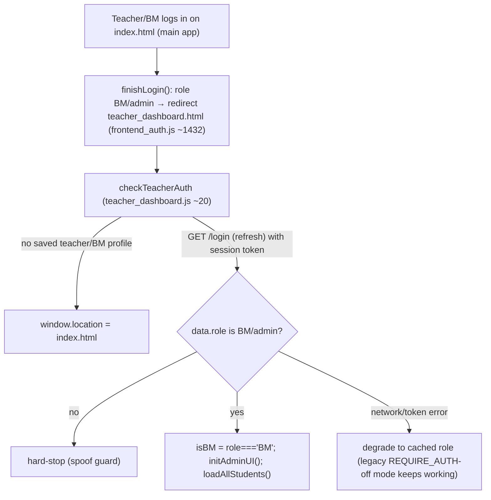

# Teacher & Admin Dashboards

The handwriting preview adds `handwritingAssisted`, displayed/filterable as
**Handwriting (with help)** for words completed using a guide/reveal. Independent
completion remains `handwriting`; skipped words are not completions.

> **Last verified:** 2026-09-27 · **Part of:** [Classroom-survivors Repo Wiki](README.md)

**Owner files:** `teacher_dashboard.html` (488 ln), `teacher_dashboard.js` (818 ln), `teacher_dashboard.css` (1151 ln), `admin_dashboard.js` (958 ln), `geo_export.js` (368 ln), `test_archive_merge_dashboard.js`

One HTML app shell (`teacher_dashboard.html`), two role views. `teacher_dashboard.js` is the base (list/filters/detail tabs); `admin_dashboard.js` (loaded AFTER it — header comment "ADMIN DASHBOARD - Additional functionality for admin role") layers on admin/BM powers: add student, settings editing, targets with manual offset, BM management. There is no separate admin HTML page — `initAdminUI()` re-skins the same shell.

## Files & load order

The BM/admin-only student `Diagnostics` tab loads `diagnostics_dashboard.js`.
It reads the separate authenticated `clientDiagnostics` endpoint, shows last
upload and device/profile activity, and can enable a seven-day trial or stop
recording remotely. All incoming text uses textContent (including error stacks).
It does not query, merge, or increment learning/session analytics. See
[Telemetry](14-telemetry.md) for limits and the interpretation of restart clues.

`teacher_dashboard.html:474-486` loads, in order:

1. `config.js`, `frontend_auth.js` (API base, `apiFetch`, app key)
2. **Inline stub:** `` — the content packs are loaded to serve the **test iframe** (`#testIframe` loads `index.html?testMode=true&…`); the stub exists so pack files parse, and `sr_engine.js`/`teaching_content.js` are deliberately NOT loaded (the dashboard never does SR math itself; it renders `srState` read-only)
3. All 7 content packs (`content_pu1/2/3.js`, `content_think0/1/2.js`, `content_test.js`), then `non_spelling_content.js` to resolve typed exercise SR IDs to authored prompts without running SR selection or changing stored progress.
4. `teacher_dashboard.js` (declares `let isBM = false` at top level, ~12) then `geo_export.js` (Student Locations panel + location exports; needs `allStudents` from the base script) then `admin_dashboard.js` (declares `let isAdmin = false`, ~6) — **do not redeclare either**; both are top-level `let` shared across the two files

`apiFetch` (defined in `frontend_auth.js`) attaches `X-App-Key` + `X-Auth-Token` automatically — dashboards never hand-roll auth headers.

## Auth & role model

- `checkTeacherAuth()` (teacher_dashboard.js ~20) re-verifies the role **server-side** via `GET /login` (token refresh) to prevent localStorage spoofing; on failure it *degrades* to the cached role so the legacy no-token dashboard still works while `REQUIRE_AUTH` is off — under enforcement the privileged data calls themselves reject.
- Roles: `admin` (full: admin columns, BM management) / `BM` (add students, edit settings/targets, no admin-only columns) / plain `teacher` (view only). `initAdminUI()` (admin_dashboard.js ~8) toggles `.admin-only` / `.admin-col` / `.bm-or-admin-col` / `.bm-or-admin-only` CSS classes and sets the title ("Admin Dashboard" / "BM Dashboard").

## Student list (teacher_dashboard.js ~60-200)

`loadAllStudents()` → `GET /getStudents?includeSecure=true` (the flag is sent for BM/admin; server re-attaches plaintext passwords only for privileged callers) → filters out non-student docs (`role !== 'BM' && role !== 'admin'`) → `populateTeacherFilter()` / `populateClassTimeFilter()` (class times re-derive from the selected teacher) → `applyFilters()` (teacher + classTime + name search) → sortable table. Detail view opens per student via `loadStudentArchives` + `switchTab`.

## Student detail tabs (teacher_dashboard.js `switchTab` ~534)

| Tab | Content |
|---|---|
| **Sessions** | `renderSessions()` — `type:'session'` events, date-filtered, with detail panel; labels via `sessionTypeLabel` (`study`/`gomoku`/`uno`/`vampireSurvivors`) |
| **Exercises** | `renderExercises()` — `type:'exercise'` events; `exerciseTypeLabel` maps `wordScramble`/`spelling`/`handwriting`/`sentenceScramble`/`sentenceMatch` + `speech_*` types |
| **Test** | `startTestMode()` (~786) — loads `index.html?testMode=true&…` into `#testIframe` to try the student's exact content assignment |
| **Settings** | `populateSettingsTab()` + `saveStudentSettings()` (admin_dashboard.js ~150/~175); the Student Locations panel sits at the bottom (see below) |
| **Targets** | `renderTargetsTab()` + `adjustTargetOffset` (admin_dashboard.js ~222/~344) |
| **SR** | `renderSRTab()` — read-only SR state explorer; per-item popup shows interval/due/last result (admin_dashboard.js ~700-724) |

## Missing Words and Find and Fix (20 October 2026)

Exercises and session details decode both object and JSON-string `itemDetails` for
`missingWord`/`findAndFix`, showing prompts, answers and book/unit/page/item ID.
The two types have their own Exercise and SR filters. Searches include readable
prompts/answers and curriculum IDs. Details wrap and are HTML-escaped; SR links
encode their JavaScript argument before escaping the HTML attribute.

SR records remain in `srState.sentences`, with their original
`non-spelling:<type>:<book>:<unit>:<page>:<id>` keys. The display separates them
from legacy sentences and resolves wording from the latest live/archive event,
falling back to the shared authored catalog for failures without a completion
event. Unknown IDs still show type/location/ID. The tab and exercise popup read
the saved intervals/results directly; they never infer SR records from exercise
completion events. Both `failure` and legacy `fail` receive failure styling.

`test_dashboard_non_spelling.js` drives the real dashboard with isolated API
fixtures, covering the reported raw JSON issue, archived object payloads, type
filters, readable search, SR popup clicks, failed-only catalog resolution,
unknown IDs, legacy rows and HTML escaping. No student writes are allowed.

## Archive merge (the reason `getStudentArchive` exists)

`saveAnalytics` trims the live doc to ~500 recent events (auto-archive ≥700). The dashboard restores full history:

- `mergeAnalytics(live, archives)` (teacher_dashboard.js ~494, **exported pure** for `test_archive_merge_dashboard.js`): concatenates archive `events` arrays onto live, de-duping by `eventId` (fallback `timestamp`) — archives may overlap the live tail.
- `loadStudentArchives(studentId)` (~508): `GET /getStudentArchive?studentId=…` → merges into `student._fullAnalytics`; shows an archive-count badge. **Fail-safe by design:** any fetch error silently keeps the live-only view; the detail view never blocks on archives.
- `getAnalyticsInRange(student, from, to)` (~203) prefers `_fullAnalytics`, falls back to `student.analytics` — all downstream counting (sessions, durations, targets) automatically sees merged history.

## Settings tab & the password-view boundary

- `populateSettingsTab()` (admin_dashboard.js ~150): fills fullName, teacher (dropdown + custom), classTime, book/unit/page cascading selects, **`settingsLogin` (read-only + copy button via `copyLogin()` ~43)** and **`settingsPassword`** with the stored plaintext (eye-toggle `togglePwVis`).
- `saveStudentSettings()` (~175) POSTs `updateStudent` with the whitelisted field set. **Load-bearing rule:** only include `password` when the box is non-empty (`if (newPw) fields.password = newPw`, ~196-197) — an empty box means "leave unchanged". The historical empty-save bug wiped real passwords; do not "simplify" this away. The password plaintext view is the sanctioned recovery path (no email reset exists) — one-at-a-time only, never bulk-export (see [Backend API](10-backend-api.md)).

## Student Locations panel & geo_export.js (2026-09-25, geo v2 2026-09-26)

The Settings tab's bottom `.admin-panel` ("Student Locations", `teacher_dashboard.html:232-246`) holds a coverage line (`#geoCoverage`, "N/M students have location data"), the student table mount (`#geoList`), the Baidu-AK input (`#geoBaiduAk`), and the two export buttons. All behavior lives in `geo_export.js`; `teacher_dashboard.js` only re-renders on `switchTab('settings')` by calling `renderGeoCoverage()` + `renderGeoList()` (~563-566).

- `renderGeoList()` (geo v2): one row per student with a **usable** geo fix (`_hasUsableFix` — finite lat AND lng; malformed docs are excluded everywhere) — name, winning ~1 km cell, `days`, `Samples (all)` (total samples across all cells, not just the winner), captured date, and a **清除位置** button → `POST /clearGeo` (with confirm; drops local `geo`/`geoSamples` and re-renders). A `同址` badge marks students whose winning cell equals another student's (`_cellShareMap`) — sibling/trip twins. Empty-state text when nobody has data yet.
- **Escaping rule (load-bearing):** the student roster table (`teacher_dashboard.js` `renderStudents`) and the bulk-action chips (`admin_dashboard.js`) paste student-writable `avatar` and roster-imported names into `innerHTML` — every such sink must go through `geo_export.js`'s `_esc()` (HTML) or `_escJsArg()` (values embedded in `onclick="fn('…')"` — quotes escaped at the JS layer *first*, because the attribute is HTML-decoded before JS parsing). Belt: `updateAvatar.js`'s `sanitizeAvatar` rejects HTML-significant or >32-char values server-side. `test_geo_export.js` + `test_dashboard_security.js` pin both. Never add raw student-data interpolations here.
- **Map tab (2026-09-28, `geo_map.js` + vendored Leaflet 1.9.4 at `lib/leaflet/`):** `switchTab('map')` → `renderGeoMap()` builds a Leaflet map on **key-less Gaode GCJ-02 raster tiles** (`webrd0{1-4}.is.autonavi.com/appmaptile…`; Gaode's routing/JS APIs need a real-name-verified key — unobtainable, see [Gotchas](15-gotchas-and-history.md)). Students with a usable fix render as orange circle-markers (GCJ-converted via `geo_export.wgs84ToGcj02` so dots sit on roads; tooltip = name + `(Nd)`, popup adds days/captured). Candidate campuses: 添加候选校区 click-to-drop, persisted in teacher-browser `localStorage.csGeoCampusPins` (GCJ coords), 清空校区 resets. Side panel: per-campus straight-line ranking (avg/median km, ≤3/≤5 km counts — haversine in GCJ space, locally equivalent to true distance) and per-student rows with **驾车** links = `uri.amap.com/navigation` deep links (key-less, opens Gaode's real driving directions). Pure builders (`buildStudentPoints`, `haversineKm`, `rankCampuses`, `gaodeDriveUrl`, pin load/save) are VM-tested by `test_geo_map.js`; fit-to-bounds is deferred one tick because the tab container has zero size on first render (zoom-0 bug class).
- Exports: `exportLocationsCsv()` → `buildLocationCsv` (v2 columns `studentId,name,hasLocation,capturedAt,days,samples,wgs84_lat,wgs84_lng,bd09_lat,bd09_lng,sharesCellWith`); `exportBaiduMapHtml()` → self-contained Baidu GL map page (marker label `name (Nd)` = `geo.days`, and the ` (Nd)` suffix renders **only when days > 1** — a single-fix student shows as a bare name; campus pins + driving-time panel remain dormant pending an AK). The AK lives in `localStorage.csBaiduAk`, teacher browser only — never sent to the server.

## Targets & the manual offset

- Creating targets: `setTargets` API (admin_dashboard.js ~295, ~519) — date range + session count per student.
- `renderTargetsTab()` (~222) shows per-target progress: `completed = countSessionsInRange(student, start, end) + (t.manualOffset || 0)`, with an amber "(+N manual)" note when offset > 0.
- `adjustTargetOffset(idx)` (~344): prompts for the **TOTAL** completed sessions, computes `manualOffset = newTotal - recorded`, persists via `updateStudent` `fields.targets`, reverts on failure. Guards: cannot set total below recorded (server events always count); prompt shows recorded vs offset vs total.
- `countSessionsInRange` (~259) applies the **2-minute rule**: game-mode losses under 120s survival time don't count toward targets (`isUncountedShortLoss`, shared from frontend_auth.js — anti-cheat from 2026-07-27, not retroactive). Same rule client-side ([Auth & Versioning](04-auth-versioning.md)) and in VS/UNO game-over ([Game Modes](06-game-modes.md)).
- `manualOffset` exists because teachers record out-of-band practice (WeChat-reported sessions) — see [Data Model](11-data-model.md) for the field's home in the student doc.

## BM management (admin only, admin_dashboard.js ~726-916)

`openManageBmsModal()` → three tabs backed by `manageBms` API:
- **List** (`loadBmsList` ~755): `GET /manageBms?action=list` → table of BM accounts.
- **Add** (`POST action:'add'` ~820): id/login/password/fullName — server stores BM passwords as scrypt hashes (unlike students — BMs never need teacher recovery).
- **Logs** (`loadBmActivityLogs` ~907): `GET /manageBms?action=logs` → the `bmActivity` audit trail written by `addStudent`/`updateStudent` (who changed what).

## API surface used by the dashboards

| Endpoint | Used for |
|---|---|
| `GET /login` | Role re-verification (token refresh) in `checkTeacherAuth` |
| `GET /getStudents?includeSecure=true` | Student list (privileged) |
| `GET /getStudentArchive?studentId=` | Archive merge |
| `POST /updateStudent` | Settings save, target delete/offset (fields.targets) |
| `POST /setTargets` | Bulk target creation |
| `POST /addStudent` | Add-student modal |
| `GET/POST /manageBms` | BM list/add/delete + activity logs |
| `POST /clearGeo` | Student Locations panel 清除位置 button (geo v2) |
| `POST /changePassword` | (student-facing; not used by dashboards) |

## Dashboard testing

- `test_archive_merge_dashboard.js` (in `npm test`): unit-tests the exported pure `mergeAnalytics` + `getAnalyticsInRange` by stubbing a minimal `document` before requiring `teacher_dashboard.js` (its DOMContentLoaded listener never fires in Node).
- `test_geo_export.js` (in `npm test`): covers `geo_export.js` — WGS→GCJ→BD conversion, the v2 CSV columns + `sharesCellWith` grouping, map-HTML data embedding, and the `_esc`/`_escJsArg` guards on `renderGeoList`'s innerHTML sinks.
- **The rest of the dashboards have NO automated coverage** (neither `teacher_dashboard.js` beyond the two helpers nor `admin_dashboard.js` are unit-tested) — the jsdom suite loads `index.html`, not `teacher_dashboard.html`. Verify `admin_dashboard.js` edits with a `vm.runInContext` harness (mind the `let isBM`/`let isAdmin` double-declaration and the `AVAILABLE_CONTENT` stub) — method in the `classroom-survivors-dev` skill's `references/dashboard_testing.md`.

## Class calendar and attendance (12 October 2026)

`class_calendar.js`/`class_calendar.css` add an admin Class Calendar panel and a month view to the shared dashboard. `api/src/functions/shared/classCalendarCore.js` is the single shared browser/server implementation of Beijing-time scheduling, attendance rates and automatic target rules. Recurrence starts **2026-10-12**, groups are keyed by teacher plus classTime, and weekday/time labels such as `Sun 16:30` recur for 90 minutes. Unparseable labels are reported instead of guessed. Calendar reads materialize a bounded future horizon; persisted classes keep stable IDs and historic roster snapshots. Future unedited class rosters follow group membership. New groups introduced later start on their first calendar-load day, rather than generating an attendance backlog.

The calendar follows the main teacher/class filters. Clicking a class opens rescheduling/cancellation controls. A reschedule changes one occurrence. Classes lock once attendance/cancellation starts. Cancellation adds 10 sessions to the group's existing practice target and extends its period by seven days, preserving its start and manual offset, regardless of progress. For example, 10 sessions from 23–30 October becomes 20 from 23 October–6 November. Each distinct subsequent cancellation adds another 10 and seven days; class-ID receipts prevent duplicate increases on retries. A cancelled class can retry unfinished target updates after a partial failure. Previously recorded cancellations are not retroactively rewritten.

**Check attendance** refreshes roster/calendar data and lists only completed classes with unrecorded student attendance, selected by default. Attended/Missed applies to the checked students, oldest classes first. Successful rows disappear immediately, failed rows remain retryable. Each student must have their earlier pending classes recorded before a later class. Recording attendance and changing that student's targets is one ETag-protected Cosmos patch, with a class-ID receipt for retry safety. Attended, or missed without reaching the preceding practice target, creates 10 sessions from class end to the next scheduled class start. Missed after reaching the preceding target adds 10 to that target and preserves its original start, extending its end to the next class. Progress includes deduplicated archived sessions, manual offsets and the same short-loss exclusions as the game.

The roster Attendance column uses its existing date-range controls; the profile Attendance tab uses the detail date filter. Rates = attended / recorded classes in the inclusive Beijing-date range; pending and cancelled classes are excluded. The profile also lists pending classes. Empty data shows “No records”, not 0%.

Bulk targets/content buttons restore their original label and enabled state in `finally`, including successful submissions. Content requests now check HTTP failures; target submissions surface per-student failures instead of silently closing the modal.

Verification: `npm run test:calendar` tests recurrence, the target examples, archive counts, cancellation/idempotency, ETag retry and both batch-button success/error paths against the real dashboard scripts.

## Update discipline

## Compact dashboard data (19 October 2026)

The dashboard requests `getStudents?view=dashboard` for its roster. The response contains profile/placement fields, attendance, the representative target for each membership, target counts and compact daily session totals. Exercise payloads, SR state, raw sessions, old targets and geo-sample histories are loaded only when opening one student's full profile. An in-memory revision allows unchanged refreshes to return 304; known prior revisions return changed/removed students only. An instance without the prior revision safely returns a complete compact snapshot. Full profile requests are scoped by student ID and can also return 304; archive history is reused until the profile changes.

The compact roster excludes typed internal documents as well as non-student roles, matching calendar/report eligibility. In particular, `delivery_diagnostics` must not become a phantom student/profile row.

Manual refresh requests the compact roster and calendar in parallel and retains the previous view on failure. Attendance checks use this same coalesced refresh; a failed refresh cannot silently offer a stale checklist. Calendar responses contain the selected month plus older unfinished classes and support 304. Save responses update the affected class and students directly, so attendance and calendar edits do not reload the roster/calendar. Explicit refresh still incorporates other-device changes.

Generate Reports independently fetches fresh report data and updates visible target progress from its small `progressUpdates` payload; it does not wait for/download the roster or calendar. Archive reads are parameterized, session-only, bounded to relevant periods, deduplicated per student and batched in groups of at most 20. Exported images/text retain only the intended report columns; account IDs are used solely for internal progress synchronization.

## Students attending multiple groups (13 October 2026)

A student keeps one account and primary teacher/class time, with additional memberships editable under **Settings → Additional Class Groups**. Save Changes refreshes group filters and future calendar rosters. The main list keeps one row per student and shows each visible group's target/period on matching lines; a class filter shows only that group's figures. Bulk target/content selection includes secondary memberships. Attendance rates combine the student's recorded classes across groups.

The Targets tab labels every period with a group, supports reassignment, and requires a group for new manual targets. When adding memberships, existing manual periods are matched to a unique group by their Beijing end weekday/time; unresolved historical periods remain untouched and can be assigned manually. Saved bindings survive rescheduling or removing a membership. Each attendance/cancellation updates only that group's targets. Practice is shared: the same session counts toward every overlapping target, with each target's own manual offset. Profile and roster target counters prefer merged archive history once loaded. Reports contain the student once in each assigned group with that group's chosen target, including memberships under another teacher.

Any agent that changes code covered by this page must update this page in the same commit. The wiki is the single source of truth; skills/memory hold only behavior rules and point here.

## Target reports for WeChat

`target_reports.js` / `target_reports.css` add the admin **Export Target Reports** action. Select one teacher and generate a fresh snapshot of all their groups, independent of the roster’s class/name/date filters. The read-only `getTargetReports` endpoint chooses each student’s current target, otherwise the latest ended target, otherwise the nearest upcoming target (matching roster selection). It counts live and archived practice sessions with event deduplication, manual offsets, short-loss exclusions, and a single server cutoff. Archive reads project only session counter fields in the selected periods and batch up to 20 students per query (a single student uses its partition). Any fetch failure rejects the entire export instead of silently producing incomplete counts. Exported rows expose only the five intended report columns and generation time; separate internal progress updates synchronize the dashboard meters.

One snapshot feeds a high-resolution dark table PNG and a Chinese message via the shared `targetReportsCore.js`. The image column heading is `PERIOD`; its dates use Beijing time. Messages separate differing Beijing-date target periods and retain explicit zero counts and unset-target labels. Each successful generation independently chooses one of ten approved practice reminders for each group, uniformly at random; repeats are allowed and no daily history is stored. The chosen closing remains on the report snapshot throughout navigation, copying and PNG/text/ZIP downloads. Regenerating draws again. Group navigation preserves edited message drafts. Copy Image uses PNG ClipboardItem (download fallback); Copy Message uses the text clipboard with selection fallback. Download all produces a local ZIP of numbered PNG/text pairs, without a third-party renderer or service. Groups without a class time are marked unassigned for review. No WeChat messages are sent by this feature.

Report images colour each student’s row, name and target badge using sessions still needed / exact remaining 24-hour days at the server generation timestamp. Green <1/day, yellow 1–2/day inclusive, reddish orange >2–3/day inclusive, red >3/day. Completed targets are green; expired unfinished targets are red; unset/invalid targets are neutral grey. Upcoming targets use their full scheduled period. Badges show the approximate daily requirement or completion/expiry status; a Chinese footer explains the colours. The same generation timestamp is stored on each group so navigation and ZIP downloads keep identical colours even when time passes.

The header Refresh Data action refreshes the compact roster and selected calendar range in parallel without reloading the page or signing out, preserves available teacher/class filters plus search/date/sort choices, and shows refresh status/time. Concurrent refresh requests share one in-flight operation. Existing rows stay visible on failure and controls recover for retry. Generate Reports fetches its independently fresh archive-aware snapshot without a roster/calendar dependency. Data GETs bypass the browser cache and carry explicit revisions where supported. Initial dashboard load uses the same refresh operation.
