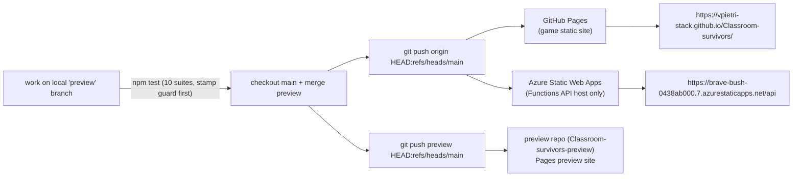

# Deployment & Release Discipline

## Automatic guides preview (2026-10-23e)

Build on current preview/main including PU1 Unit 7 (2026-10-23d). Remove the guide
button and automatically display guides after two meaningful failed attempts.
Only a subsequent guided failure unlocks session skip. Publish to preview/main
only. Refresh the changed study query and narrow preview SW cache; keep unchanged
recognizer/model source queries so existing checked model caches remain reusable.

## Session skip and erasers preview (2026-10-23c)

Publish to preview/main only, including the normal index.html Study flow and the
shared account-free handwriting page. Skip is hidden until a meaningful guided
failure, then remains available for the rest of the Study session. Use distinct
single-stroke/whole-letter SVG erasers. Recognition weights are unchanged.
Refresh shared style/study queries, synchronized auth stamps and the narrow
preview SW. Verify the hosted main entry as well as the account-free test page.

## Guide access preview (2026-10-23b)

Build on current preview/main, including the approved PU1 Unit 6 release. Publish
only to the preview remote. Gate manual hints after two meaningful failed writing
attempts, exclude taps and remove automatic guide display at the second failure.
Weights and recognition decisions are unchanged. Refresh the narrow preview SW
cache/runtime queries and synchronize all version/auth/index/dashboard stamps.

## Handwriting preview (2026-10-22c)

Publish this handwriting integration to `preview` remote `main` only; production
requires a later explicit release request. Preserve preview's curriculum/API/data.
Synchronize the three version/auth/index stamps and dashboard auth reference;
refresh changed study/handwriting/style/dashboard script cache-busters. Include
all `handwriting_model/` runtime/manifest/weight files. The account-free
`handwriting_preview.html` offers a direct test without account data or capture.
Its offline SW is scoped to the `handwriting_preview` URL prefix, with no change
to the main app's update worker. On a later preview-shell/runtime change, bump
the narrow SW cache name and runtime query versions together to avoid stale
cache-first assets. Model weights are separately keyed by SHA-256.
The first hosted check exposed a slow cold weight fetch. Release b allows
30 seconds per background weight attempt plus one retry, while input/hint/skip
remain usable. A failed warm-up can retry at the next round entry; internal
`HWRecognition.status()` identifies the failing phase.

## Typed exercise dashboard release (2026-10-20a)

Release the Missing Words/Find and Fix dashboard presentation and SR lookup fix
to preview first, verify hosted details/filters/popups, then promote the same
dashboard change on the production remote's existing main. Preserve each site's
curriculum, feature gates, API routing and isolated data. The dashboard loads its
own site's existing `non_spelling_content.js` for failed-only SR descriptions;
this release does not publish preview curriculum to production or rewrite SR
records. Refresh dashboard JS/CSS cache busters and synchronize version/auth/index
stamps plus the dashboard auth script reference. Production requires successful
Pages and Azure workflows and verification of the served dashboard assets.

## Vocabulary normalization release (2026-10-17a)

Publish to preview first and verify hosted stamps, vocabulary/SR/translation
scripts, 45 image aliases and 101 verified audio assets before pushing production.
Build each release on its remote's existing `main`; do not merge preview history
into production or change the preview API/container or either site's feature gates.
The release excludes Think2 and restores original vocabulary in PU1 Units 0-3.
The version/auth/index stamps and changed book/SR/translation script cache busters
advance together, including the teacher-dashboard references. Existing SR records
remain readable through the legacy-key compatibility map; no database rewrite is
performed. Production is complete only after both Pages and Azure workflows pass
and served content/assets match the validated local release.

> **Last verified:** 2026-09-04 · **Part of:** [Classroom-survivors Repo Wiki](README.md)

**Owner files:** `AGENTS.md`, `DEPLOY_VERSION_STAMP.md`, `.github/workflows/azure-static-web-apps-brave-bush-0438ab000.yml`, `package.json`, `test_deploy_stamp_sync.js`, `version.json`, `staticwebapp.config.json`

Two hosting surfaces, one push:



The Pages site URL above is verified against the repo itself: the SWA workflow's stub
`index.html` literally points to it (workflow line 35), `config.js:11` targets the SWA API
hostname, and `staticwebapp.config.json` sets `Access-Control-Allow-Origin:
https://vpietri-stack.github.io`. Note there is **no dedicated Pages workflow file** —
GitHub Pages deploy-from-branch is configured in repo Settings (source: `main`, root), evidenced
by `.nojekyll` at root and the absence of any `pages-build` workflow; the only tracked workflow
is the Azure SWA one.

<!-- VERIFY: the exact Pages configuration (branch + folder) lives in GitHub repo Settings, not in the repo — confirm in the UI if precision is required. A preview repo serves /Classroom-survivors-preview/ (config.js:52 keys TD gating off that path). -->

## 1. GitHub Actions workflows

There is exactly **one** workflow file in the repo:

| | `azure-static-web-apps-brave-bush-0438ab000.yml` |
|---|---|
| Name | **Azure Static Web Apps CI/CD** |
| Triggers | `push` to `main` or `v2-login`; `pull_request` (opened/synchronize/reopened/closed) against those branches |
| Job guard | `github.repository == 'vpietri-stack/Classroom-survivors'` — the **preview repo has no SWA token secret**, so it never deploys Azure (workflow line 18); it is Pages-only |
| What deploys | **API only.** The SWA exists solely to host `/api` Functions; the game is served by GitHub Pages. A minimal app dir `swa_app/` is staged (routes config + stub index + CI-injected `app-config.json`) because uploading the whole repo exceeds the Free tier's 250 MB app limit |
| Steps | checkout → stage `swa_app/` (copies `staticwebapp.config.json`) → inject client app config from secret `APP_CLIENT_KEY` (workflow lines 36–42) → `Azure/static-web-apps-deploy@v1` with `app_location: swa_app`, `api_location: api`, `skip_app_build: true` |
| Secrets used | `AZURE_STATIC_WEB_APPS_API_TOKEN_BRAVE_BUSH_0438AB000`, `GITHUB_TOKEN`, `APP_CLIENT_KEY` (value never in repo) |
| Close-PR job | Second job runs `Azure/static-web-apps-deploy@v1 action: close` on PR close |

Pages and SWA are **separate Actions runs triggered by the same push** to `main` of `origin`
(AGENTS.md "Deploy pipeline"). The Pages build takes ~1–2 min after push; the served
`version.json` has been observed to lag the push by ~90 s (`HANDOFF_SESSION_REFRESH_FIX.md`
round-4 note).

## 2. Branch & remote model

Remotes (verified from `git config`):

| Remote | URL | Role |
|---|---|---|
| `origin` | `https://github.com/vpietri-stack/Classroom-survivors.git` | **LIVE**: GitHub Pages + Azure SWA both build from its `main`. |
| `preview` | `https://github.com/vpietri-stack/Classroom-survivors-preview.git` | **PREVIEW** Pages site (`/Classroom-survivors-preview/` path). |

Branches: local `preview` (working/integration), local `main` (what ships), plus a stale
`feature/ui-mobile-child-friendly`. Gotcha: a local branch `preview` AND remote `preview/main`
both exist → `git` warns "refname 'preview' is ambiguous"; use full refs
`refs/heads/preview`, `refs/remotes/preview/main` (`HANDOFF_SESSION_REFRESH_FIX.md` §1).

**Standard release cycle** (AGENTS.md):

1. Do the work on local `preview`; commit staged paths only (`git add <file> …` — never
   `git add -A`/`git add .`).
2. `npm test` green (root suite) and `cd api && npm test` for backend changes.
3. `git checkout main && git merge preview`.
4. `git push origin HEAD:refs/heads/main` **and** `git push preview HEAD:refs/heads/main`
   (explicit refspec — **not** `git push preview preview`).
5. Keep all four refs equal: `main`, `preview`, `origin/main`, `preview/main`
   (verify with `git rev-parse refs/heads/main refs/heads/preview origin/main preview/main`).

Runtime feature gating is what makes this merge-safe: `TD_ENABLED` / `THREE_TD_ENABLED`
(`config.js:45/61`) are detected **at runtime from the URL path** (preview path or
localhost/file:// or `?td=`/`?3d=`), so a merge never flips a per-branch flag.

## 2a. Worktrees — one per feature, one feature per conversation

The working directory is shared by several sessions at once, so `git checkout`
in it rewrites files under whatever else is running. That has already cost real
work: on 2026-10-05 another session's `branch: Reset to d3014dc` discarded an
agent's uncommitted ~250-line `handwriting.js` edit. It had never been staged,
so `git fsck --unreachable` held no blob for it, `hw/main` already equalled the
local tip, and Qoder local history had no snapshot — unrecoverable.

The model is **one conversation per feature**, each in its own checkout, while
the Qoder workspace folder stays the main repo so `AGENTS.md`, this wiki and
project memory still load. Opening a worktree as its own workspace instead gives
it a fresh project key with **zero** memory — the ~126 accumulated notes would
simply not be there.

`wt.sh` (repo root, Git Bash) gives each feature its own checkout over the one
shared `.git`:

| Command | Does |
|---|---|
| `./wt.sh new <branch> [base]` | Creates `../Classroom-survivors-wt/<branch>` off `refs/heads/preview` by default, and junctions `node_modules/` + `api/node_modules/`. |
| `./wt.sh where` | Prints the current checkout + branch; **exits 3 with a warning if you are standing in the main checkout.** Run before the first write. |
| `./wt.sh ls` / `path <b>` | List worktrees / print a directory for scripting. |
| `./wt.sh rm <branch>` | **Unlinks the junctions first**, then `git worktree remove`. Refuses if the worktree has uncommitted work. Keeps the branch. |
| `./wt.sh clean` | `git worktree prune` for worktrees deleted by hand. |

Design decisions worth not re-litigating:

- **`where` exists because this model has a sharp edge.** The workspace root is
  the main repo while the work lives in a sibling folder, so every default
  relative path resolves to the **wrong** tree. An agent that edits
  `frontend_auth.js` without checking has edited the copy another session is
  running. Assert the location; don't assume it.
- **Worktrees are siblings (`<repo>-wt/`), not `.worktrees/` inside the repo.**
  No `.gitignore` change is needed, and a stray `git add` in the main checkout
  can never swallow a second copy of the project. Both GitHub repos are public.
- **Dependencies are junctioned, not installed.** `node_modules/` and
  `api/node_modules/` are gitignored, so a fresh worktree has neither and
  `npm test` fails with a misleading `Cannot find module '@azure/functions'`
  (it comes from `api/src/functions/saveAnalytics.js`, not from a missing root
  dep). One junction each: identical versions everywhere, ~37 MB saved per
  feature. Verified 2026-10-05: `npm test` in a fresh worktree, 485 assertions,
  0 failures.
- **`wt.sh rm` exists because `rm -rf` is dangerous here.** `git worktree
  remove` walks the tree; a walk that follows a junction deletes the real
  `node_modules`. The script calls PowerShell's `$item.Delete()` on the reparse
  point before removing anything.
- **Bare `preview` is ambiguous** (local branch *and* remote name — see §2), so
  `wt.sh` resolves names through `refs/heads/<x>` first. Without that,
  `wt.sh new x preview` dies with `fatal: ambiguous object name`.

Split work along **files**, not topics: `images/vocab/*.png` is conflict-free
(new filenames), while `index.html`, `content_<book>.js` and the stamp trio are
where features collide — sequence those two conversations rather than running
them at once. Agents never touch the stamp trio; the integrator bumps all three
once on the merged result (§2b).

Verified end to end on 2026-10-05: created a worktree through the bootstrap from
a branch that did not yet contain `wt.sh`, ran the suite through the junctions
(485 assertions, 0 failures), removed it, and confirmed the main checkout's real
`node_modules` survived.

## 2b. The version bump checklist (the gate)

Every deploy that clients must pick up requires the **three stamps** to be bumped together —
see [Auth & Versioning](04-auth-versioning.md) for the watchdog mechanics:

1. Pick a stamp `YYYY-MM-DD` + optional lowercase letter (comparison: year → month → day →
   letter). Current: `2026-09-25a`.
2. Set all three: `version.json` `"version"` · `frontend_auth.js` `const APP_VERSION` ·
   `index.html` `frontend_auth.js?v=` (script-tag line ~731).
3. `npm test` must pass — `test_deploy_stamp_sync.js` runs **first** and exits non-zero on any
   drift, so a mismatch cannot ship through the normal gate.
4. Other scripts' `?v=` stamps in index.html: bump the file's stamp too if clients must pick
   up that file immediately (historical stamps are per-file, e.g. `study_mode.js?v=2026-08-26a`).
5. Deploy, then verify live: fetch the served `frontend_auth.js` and confirm `APP_VERSION`
   matches the served `version.json` (allow ~90 s of Pages-build lag).

## 3. The GitHub Pages wedge (known failure mode)

A prior "in progress" Pages deployment blocks the next one:

```
Deployment request failed ... due to in progress deployment. Please cancel <sha> first
```

- The modern Pages Settings UI has **no cancel button**.
- It **self-resolves in ~30–90 min** (the lock rolls forward), or
  `gh run rerun <pages-run-id>` once the lock rolls forward.
- **Do NOT thrash** with repeated pushes — each new push just queues behind the same lock.
- **Do NOT click "Unpublish site"** — that is destructive and unnecessary.
- One rerun after the wedge clears is enough (AGENTS.md; DEPLOY_VERSION_STAMP.md §"If you broke it").
- This bit for real on 2026-08-30: `version.json` was bumped alone, the other two stamps were
  forgotten, and recovery required a full Pages-deploy unstick (AGENTS.md Rule 1).

## 4. GFW reality (mainland-China connectivity)

- GitHub connectivity from mainland China is **lossy**: `git push` to port 443 intermittently
  resets — retry 3–5× with ~1 min gaps; it clears (`HANDOFF_SESSION_REFRESH_FIX.md` §1).
- This is also why the game self-hosts everything (Tailwind, fonts, Font Awesome,
  `lib/tailwind.js` instead of the CDN) and why `asset_cache.js` routes asset downloads through
  the `gh-proxy.com` mirror first on `*.github.io` pages — see [Frontend Core](03-frontend-core.md).
- Release verification curls (`version.json`, served JS) may need retries too.

## 5. Operational gotchas from the handoff history

| Gotcha | Detail |
|---|---|
| Ambiguous refname | Local `preview` vs remote `preview/main` — always use full refs. |
| PowerShell-only hosts | Long one-liners crash PSReadLine and silently drop chained commands; re-verify each ref with short commands after a chained deploy. |
| Push noise | `git push` progress on stderr looks like an error in PowerShell; judge by the `oldsha..newsha HEAD -> main` line. |
| Parallel sessions | A speech-recognition session may commit in the same worktree; check `git status` before staging; leave `api/speech_events_dump_full.json` untracked. |
| Test gate | `npm test` = 10 suites (order in `package.json:7`, stamp-sync first); backend: `cd api && npm test`. |
| Verify deployments | SWA: build record `Ready` + runtime evidence (e.g. archive docs created by live traffic). Pages: fetch `version.json` and grep served `frontend_auth.js` for the stamp. |

## 6. Quick reference: what ships where

| Component | Deployed by | Source | Notes |
|---|---|---|---|
| Game static site | GitHub Pages (repo Settings, deploy from `main`) | `origin/main` | `.nojekyll` present; ~1–2 min build. |
| Preview site | GitHub Pages | `preview` repo `main` | Serves under `/Classroom-survivors-preview/`. |
| Functions API | Azure Static Web Apps CI/CD workflow | `origin/main` (`api/` dir) | Minimal staged app; runtime feature flags from `config.js`. |
| Whisper model + big assets | Not "deployed" — fetched at runtime | `models/`, `sprites/`, `audio_mp3/`, `music/`, `sfx/` | Downloaded via `asset_cache.js` mirror logic / speech engine raw URLs. |

## Admin dashboard preview deployment (13 October 2026)

The multi-group preview release uses stamp `2026-10-13g`, including refreshed admin/shared-core cache busters. Selena's additional Sunday 16:30 membership is configured in the preview copy only; existing target dates, goals and offsets are preserved. Production accounts and `origin/main` remain unchanged.

The admin calendar preview is deployed from `admin-dashboard-update`, integrated with the current `preview/main`. Only the preview repository's `main` is updated; `origin/main` stays unchanged. A draft PR against `origin/main` triggers the existing Azure workflow's **PR environment**, providing a separate API hostname. The preview path in `config.js` is routed to that hostname; other paths retain the production API. Keep the draft PR open while this preview is needed (closing it removes the PR API environment).

Draft PR #1 provides `https://brave-bush-0438ab000-1.eastasia.7.azurestaticapps.net/api`. It uses `COSMOS_DB_NAME=Val-EslApp`, `COSMOS_CONTAINER_NAME=Students-admin-dashboard-preview`, and `REQUIRE_AUTH=true`. The preview container shares the existing database throughput and contains a copy of account data and practice-session history (including archived sessions), so attendance/target testing does not alter live Students records. Large historical exercise payloads are omitted from the copy. Existing logins are available in the copy. Research capture enable lists are empty in the PR environment. Credentials are read through the authenticated Azure CLI and passed directly to the PR environment without printing them; the temporary local `api/.admin-dashboard-preview-settings.json` is gitignored. Do not overwrite this container on later preview deploys, because that would erase the user's test changes.

The initial calendar deployment used synchronized stamp `2026-10-13a`; the target-report follow-up uses `2026-10-13b` and the image-heading adjustment uses `2026-10-13c`, and randomized report closings use `2026-10-13d`, and target-pace image colours use `2026-10-13e`, and manual/automatic dashboard refresh uses `2026-10-13f`. Reuse the same PR API and preview container for follow-up deployments. Validation includes the complete current frontend suite, the 26 private auth-integration assertions against `Val-EslApp-Test`, a real Functions/Cosmos calendar smoke test in that isolated database, and the Chrome dashboard smoke test. Verify both Pages assets/stamps and the PR environment's calendar endpoint before reporting the preview ready. Target-report validation also includes real isolated-Cosmos projection/JOIN counts, Chrome clipboard/navigation/download checks, ZIP CRC/UTF-8 verification, and the deployed report endpoint/UI.


## Speech research preparation (2026-10-15)

Follow the [speech collection rollout](../speech-collection-rollout.md).
Frontend and API changes must both be published before enabling expanded intake.
The explicit enable switch defaults off; consent remains a private allowlist.
Index preparation defaults to dry-run, backs up before an explicit apply, and
never provisions database throughput. Keep the normal production approval and
stamp discipline. A preview Pages push alone cannot validate the new API.

### Wider speech collection release (2026-10-16)

Release `2026-10-16c` integrates the bounded collector with current production
curriculum. The teacher confirmed consent for all current users and authorized
publication/activation. The several days of home collection already provide
the initial pilot; validate the new safeguards without restarting it. Snapshot
current student account IDs privately, publish with capture disabled, apply and
verify only the audio index exclusion, then enable the exact approved list.
Future accounts are not automatically consented. Keep the 30-recording cap,
October 18 closing date, existing service tiers and throughput. Publish preview
separately from its current history, preserving its isolated API/container.

## Update discipline

## Dashboard data efficiency (19 October 2026)

Release `2026-10-19g` replaces full-roster downloads with compact snapshots and
revision deltas, loads full profiles on demand, batches bounded practice reads,
and updates attendance rows directly. Calendar generation metadata prevents
repeated reconciliation on unchanged refreshes. Publish and verify preview
Pages plus the existing draft PR #1 API first, preserving its isolated container
and current preview-only curriculum. Production is released from its own main
history with the same dashboard changes, without merging the preview PR history
or closing that API environment. Synchronize the stamp trio and dashboard script
cache busters. Validate the full root suite, private auth suite, isolated Cosmos
attendance/archive/retry integration, and served API/UI before completion.

## PU3 Unit 9 page 109 release (13 October 2026)

Stamp `2026-10-13i` publishes the teacher-approved before/when/after lesson to both production and preview Pages. The release updates all three version stamps, the `content_pu3.js` / `translations.js` cache busters, and the teacher dashboard's auth/content cache busters. The existing preview-path API routing and isolated preview container are preserved; no account or target data are migrated. The lesson is applied separately on each remote's current main history so production does not merge/close draft PR #1 (which hosts the preview API). Deployment is performed from feature worktrees so other sessions' uncommitted changes in the shared main checkout remain untouched.

Any agent that changes code covered by this page must update this page in the same commit. The wiki is the single source of truth; skills/memory hold only behavior rules and point here.

## New exercise preview rollout (2026-10-13)

The mixed round and typed challenges are runtime-fenced by NON_SPELLING_ENABLED
to preview/local development. Publish this feature to the preview remote's main
only. Production enablement and publishing require the later release request.
The release integrator bumps the stamp trio together and cache-busts changed
config/game/study scripts after merging the feature, once at preview ship time.

Approved Unit 2 content is published to preview only as `2026-10-14c`, including
the 16 missing-word and 20 find/fix boards under page 28. The synchronized stamp
trio and the curriculum script cache buster are updated together; the dashboard
auth link also loads the current shared version. Production remains a separate
release and preview retains its existing isolated API/data.

Unit 3 preview release `2026-10-14d` adds 22 M/27 F boards to page 40, retaining
Units 1/2/9. Curriculum and widget cache busters advance with the synchronized
stamp trio and dashboard auth link. Production is not part of this deployment.

Unit 4 preview release 2026-10-14e adds 16 M/20 F boards to page 54 and locked first-letter support in the shared Study/game widget. Curriculum/widget cache busters and the stamp trio advance together. Unit 5 remains review-only; production and isolated preview data are unchanged.

Unit 5 preview release 2026-10-14f publishes the approved 16 M/20 F boards across pages 57, 59 and 66. The curriculum cache buster advances with all three version stamps and the dashboard auth link. Existing preview API/data and production are unchanged. Unit 6 is still a content proposal.

Unit 6 preview release 2026-10-14g publishes the approved 26 M/34 F boards across pages 69, 71 and 73, including the teacher edits to M11/M21/M25 and F23/F25/F26/F27/F30. Curriculum cache busting, the stamp trio and dashboard auth link advance together. No production or backend/data changes are included; Unit 7 remains a proposal.

Unit 7 preview release 2026-10-14h publishes the approved 26 M/32 F boards across pages 83, 85 and 87, including M23-M26 and F29-F32 for if/when. Curriculum cache busting, the stamp trio and dashboard auth link advance together. Production and existing preview API/data are unchanged; Unit 8 remains a proposal.

Unit 8 preview release 2026-10-14i publishes the approved 23 M/32 F boards on pages 95, 97, 98 and 99. It includes attached contraction rendering, M10 removal and the edited M15/M16. Curriculum/widget/CSS cache busters advance with the stamp trio and dashboard auth link. Production and existing preview API/data are unchanged.

Unit 9 preview release 2026-10-14j adds the approved page 107 M/F items and new pages 110/111 vocabulary, sentence scrambles, pairs and M/F items. Changed content/translation cache busters, the stamp trio and dashboard auth/content links advance together. Page 109, production and existing preview API/data remain unchanged.

The 2026-10-14k startup hotfix guards missing curriculum entries in non_spelling_content.js. Its cache buster and the version/auth/index stamp trio advance together, including the dashboard auth URL. The production hotfix is based on production main; preview receives the same guard on its own main. PU3 curriculum proposals/assets and the isolated preview backend are not promoted by this fix.

Preview release 2026-10-14l publishes the 48 approved PU3 flashcard PNGs and the combined review gallery at outputs/pu3-flashcards/index.html. Every final PNG is below 100,000 bytes. All three version stamps and the dashboard auth URL advance together; the previously deployed Study startup guard remains intact. These are new asset filenames, so existing cached image versions need no invalidation. Production and the isolated preview API/data remain unchanged.

Preview-only 2026-10-14m corrects PU1 U2 and PU2 U4 availability. Both changed book-pack cache busters advance in the student page and dashboard; the stamp trio and dashboard auth link remain synchronized. Existing 48 PU3 flashcards and the missing-page guard are retained. Production is not updated by this release.

Preview release 2026-10-15a publishes only the approved PU2 Unit 1 22 M/24 F boards. The non-spelling curriculum cache buster advances with the synchronized stamp trio and dashboard auth link. Production and isolated preview API/data remain unchanged; PU2 Unit 2 is still a review-only proposal.

Preview release 2026-10-15b publishes the approved PU2 Unit 2 typed boards and Tuesday/Monday pair correction. The book-pack and non-spelling curriculum cache busters advance with the synchronized stamp trio and dashboard auth link. Production and isolated preview API/data are unchanged; Unit 3 remains review-only.

Preview release 2026-10-15c publishes the approved PU2 Unit 3 typed boards. The non-spelling curriculum cache buster advances with the synchronized stamp trio and dashboard auth link. Production and isolated preview API/data are unchanged; Unit 4 remains review-only.

Preview release 2026-10-15d publishes the approved PU2 Unit 4 30 M/40 F typed boards, including than and floor/roof practice. The shared curriculum cache buster advances with the synchronized stamp trio and dashboard auth link. Production and isolated preview API/data are unchanged; Unit 5 remains review-only.

Preview release 2026-10-15e publishes approved PU2 Unit 5 boards with teacher annotations applied. The curriculum cache buster, version/auth/index stamps and dashboard auth URL advance together. Production and preview API/data remain unchanged; Unit 6 is review-only.

Preview release 2026-10-15f publishes approved PU2 Unit 6 boards, removing M5/F5 and applying the M13/M14 contraction edits. The curriculum cache buster and synchronized version/auth/index/dashboard stamps advance together. Production and preview API/data remain unchanged; Unit 7 is review-only.

Preview release 2026-10-15g publishes approved PU2 Unit 7 boards with the teacher's M1 cheese-sandwich edit. The curriculum cache buster and synchronized version/auth/index/dashboard stamps advance together. Production and preview API/data remain unchanged; Unit 8 is review-only.

Preview release 2026-10-16a publishes approved PU2 Unit 8 boards with the teacher's twelve annotations applied. The curriculum cache buster and synchronized version/auth/index/dashboard stamps advance together. Production and preview API/data remain unchanged; Unit 9 is review-only.

Preview release 2026-10-16b publishes approved PU2 Unit 9 with all teacher annotations, expanded grammar blanks and F22/F23 omitted. The curriculum cache buster and synchronized version/auth/index/dashboard stamps advance together. All nine PU2 units are prepared for the explicitly authorized production promotion using a separate production-based worktree.

Preview release 2026-10-19a adds the approved PU1 Units 0-1 31 M/38 F boards. The non-spelling curriculum cache buster advances with the synchronized version/auth/index stamps and dashboard auth link. The release builds on current preview main, retaining its vocabulary and speech updates. Production and isolated preview data are unchanged; Unit 2 is a proposal.

Preview release 2026-10-19b publishes the approved PU1 Unit 2 26 M/36 F boards. The curriculum cache buster advances with the synchronized version/auth/index stamps and dashboard auth link. Existing preview API/data and production are unchanged; Unit 3 remains a review draft.

Preview release 2026-10-19c publishes approved PU1 Unit 3 28 M/36 F boards. The curriculum cache buster advances with the synchronized version/auth/index stamps and dashboard auth link. Production and the isolated preview API/data are unchanged; Unit 4 is a review proposal.


## Speech collection extension (19 October 2026)

Release `2026-10-19d` extends both fixed collection deadlines to
`2026-10-26T00:00:00+08:00`, end of Sunday October 25 China time, following the
teacher's explicit approval after the Monday review. Publish frontend and API,
then update only `SPEECH_SAMPLE_CAPTURE_ENDS` to that instant. Preserve the
existing enable switch, exact consent list, 30-recording lifetime cap, existing
quota records, upload bounds and throughput. Browser collection cache counter
advances to 4. Production and preview are released from their own current
histories, retaining their curriculum and API routing. Verify live reopening
and the new cutoff without uploading synthetic audio to production.

Preview release 2026-10-19e publishes approved PU1 Unit 4 22 M/32 F boards with all teacher annotations applied. The curriculum cache buster, version/auth/index stamps and dashboard auth link advance together. Production and isolated preview API/data are unchanged.

Preview release 2026-10-20b publishes the approved PU1 Unit 5 28 M/36 F boards with contextual toy/shape clues, longer locked prefixes and plural repairs. Build on current preview main to retain the dashboard updates. Refresh the curriculum cache buster in both the app and dashboard, synchronize version/auth/index stamps and the dashboard auth link, and verify hosted files after Pages succeeds. Production and isolated preview API/data are unchanged.

Preview release 2026-10-21a adds the Round C per-word handwriting skip button, labelled `跳过这个词的书写` (skip writing this word). It retains the current preview curriculum and API configuration. Refresh the Study Mode cache buster, synchronize version/auth/index stamps, and verify the hosted files and skip flow after Pages succeeds.

The narrow preview offline worker reuses the checked model cache instead of
downloading the model a second time during installation.

Preview release 2026-10-23a adds the approved PU1 Unit 6 32 M/46 F boards with all teacher edits and there/their/they're practice. Retain current preview handwriting updates, feature gates and isolated API/data. Synchronize version/auth/index stamps and the dashboard auth link, refresh both app/dashboard curriculum cache busters, and verify hosted files after Pages succeeds. Production is unchanged.

Preview release 2026-10-23d adds approved PU1 Unit 7 28 M/36 F boards and locked-ending support for the teacher's swimming-pool blank. Retain current preview handwriting updates and isolated API/data. Synchronize version/auth/index/dashboard stamps, refresh curriculum cache busters in both entry pages and the shared widget cache buster in index, then verify hosted files after Pages succeeds. Production and Unit 8 content are unchanged.


## Cancellation target correction (2026-10-27a)

New class cancellations add 10 sessions as well as seven days to the existing group target. Existing cancellation receipts remain unchanged. Publish independently on current preview/production histories, retaining their curriculum, routes and data; deploy the existing PR #1 API before promoting production. Synchronize the stamp trio and dashboard auth/calendar/core cache busters. Verify the served rule and cancellation retry behaviour without altering real student attendance.
